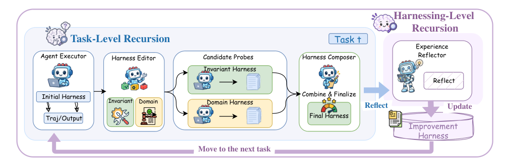

# Harness^2: Recursive Agent Harnessing for an Open World

> Google Cloud AI Research / Northwestern University · 2026-10-09 · paper · **闭环** · [论文](https://arxiv.org/abs/2610.14224) · [仓库](https://github.com/google-research/harness2)
> 机制族：Harness 搜索与进化 · 来源核验 2026-10-16 · 复现状态 not-run

## Pipeline

在 K=8 个可编辑组件的 harness（系统提示、护栏、记忆、技能、工具指引、脚本、子代理、TypeScript 中间件）上做两层递归。任务级 Propose-Probe-Compose：先以当前 harness 跑一次参照执行，再提出“不变式”候选（跨领域代理缺陷）与领域专用候选各一；Probe 在匹配配置下重跑各候选，把轨迹与交付物同参照对比得到行为反差（缓解/中性/退化），全程不用真值验证器；Compose 选择性合并受支持的编辑、修订冲突、采纳其一或保持不变——每个决定都绑定具体观察而非假想的分数增益。并行递归探 k 个候选并从池中组合；串行递归链式 k 步反差。harness 级：每个任务后由反思从完整改进记录提炼教训，只保留有反差支撑者；被采纳 harness 与一条 EXPERIENCE.md 条目进入带索引的改进库。默认 harness 编辑器为 OpenCode 下的 Claude Opus 4.8。

*图源：Figure 3 (S2.F3), arXiv HTML v1*
## 结果（作者报告，非本地复现）

在三个专业基准与四个模型-harness 配置（冻结的 GLM-5 与 Gemini 3.5 Flash 执行器 × OpenCode 与 Codex 基线 harness）上，单步递归增益最高 WorkBuddy-Bench +11.5 分（GLM-5/OpenCode 64.2→75.7）、JobBench +4.5（Gemini 3.5 Flash/OpenCode）、LAB partial +11.8 个百分点（GLM-5/OpenCode 59.6→71.4）；递归预算 k 从 1 到 5 时并行与串行两种形态均单调提升（k=5 并行更高），按基准-配置再加约 +2.6–6.7 个百分点。

## 证据边界

无正确性或迁移保证：反差与模型判断对执行变异和共享模型偏置敏感。负结果：ReasoningBank 在编码任务上最多低于基线 6.6 分；Harness Scaling 在 12 个基准-配置对中的 7 个劣于基线且 k=2→3 退化；LAB 上 Gemini 3.5 Flash/Codex 由 Meta-Harness 领先。9 例退化的失败分析：匿名交付物选择失当（选中 55 分而弃 95 分）、错误前提传播（损失 2–11 分）、无法归因的变异。递归需额外执行与编辑器会话。

## 对 nanoRSI 的输入

反差探测是 nanoRSI 在开放任务上缺失的免验证器闸门：父代跑一次取参照，子代在匹配配置下重跑，比较轨迹/交付物，只接受有反差支撑的编辑——不用分数、评分表或真值。带逐条出处与留一复用审计（其图 10/11）的索引化改进库，是 nanoRSI 种群簿记在记忆面上的镜像。

## 来源

[arXiv abstract](https://arxiv.org/abs/2610.14224) · [arXiv HTML v1](https://arxiv.org/html/2610.14224v1) · [harness2 code](https://github.com/google-research/harness2) · [harness2 project page](https://harness2.github.io)
