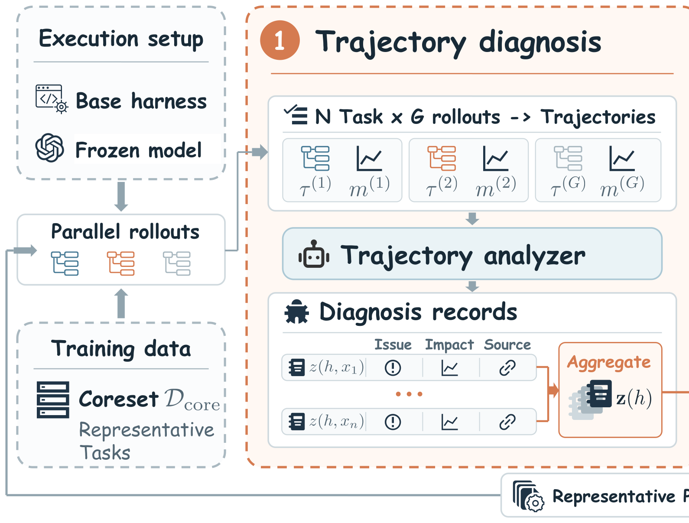

# HarnessPro: Recursive Harness Self-Improvement with Pareto Optimization for Performance-Cost Trade-offs

> Tsinghua University / Z.AI Co., Ltd. / Shanghai Jiao Tong University / University of Warwick / Kuaishou Technology · 2026-10-20 · paper · **闭环** · [论文](https://arxiv.org/abs/2610.26770) · [仓库](https://github.com/pzs19/HarnessPro)
> 机制族：Harness 搜索与进化 · 来源核验 2026-10-21 · 复现状态 not-run

## Pipeline

性能-成本 Pareto 目标下的无标签递归 harness 演化。每轮：专用智能体诊断执行轨迹、按不同性能-成本优先级规划更新并实现为候选 harness；候选用 LLM 生成的测试评估（无标准答案或官方测试），经归一化加权平方距离选择给出三个代表——成本优先（lite）、均衡（medium）、性能优先（heavy）——在留出评估前固定；入选 harness 带执行反馈进入下一轮。

*图源：Figure 1 (HarnessPro_Main_Figure.svg), arXiv HTML 2610.26770v1, rendered to PNG*
## 结果（作者报告，非本地复现）

在 Terminal-Bench 2、SWE-Bench Pro 与 ProgramBench 上（GPT-5.5 + Codex），heavy 模式较 RHO 平均 +2.0 通过率点、每任务成本降 26.1%（平均延迟 520 秒降至 412 秒）；GLM-5.2 + Claude Code 下优势保持；lite 模式以更低成本在三基准上均胜过原始 harness。

## 证据边界

评估效度依赖 LLM 生成的测试（对判分结果的混淆矩阵有报告但并非标准答案）；绝对增益温和（约 2 点）；结果绑定两套 agent 栈（Codex、Claude Code）与三个基准。

## 对 nanoRSI 的输入

把成本变成一等选择轴：证据账本已按候选计 token——在冻结测试前固定并报告一条 Pareto 前沿（便宜/均衡/昂贵的代），而非单一最高分赢家。

## 来源

[arXiv abs 2610.26770](https://arxiv.org/abs/2610.26770) · [arXiv HTML v1](https://arxiv.org/html/2610.26770v1) · [pzs19/HarnessPro (MIT)](https://github.com/pzs19/HarnessPro) · [HarnessPro LICENSE (MIT)](https://raw.githubusercontent.com/pzs19/HarnessPro/master/LICENSE) · [Live demo](https://pzs19.github.io/HarnessPro/)
