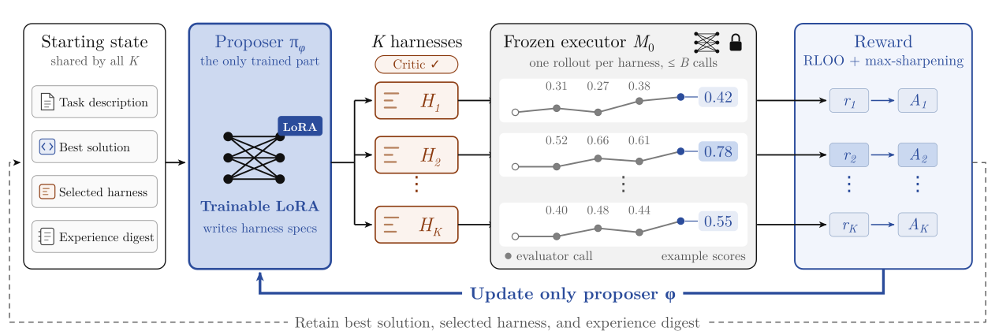

# HarnessTTT: Learn to Optimize Harness at Test-Time for Scientific Discovery

> University of Wisconsin-Madison / NVIDIA / Johns Hopkins University / Stanford University / Meta · 2026-10-12 · paper · **闭环** · [论文](https://arxiv.org/abs/2610.17370)
> 机制族：Harness 搜索与进化 · 来源核验 2026-10-16 · 复现状态 not-run

## Pipeline

执行器冻结、在测试时训练 harness 提案器：提案器（执行器模型 + 持久 rank-64 LoRA，每轮 3 epoch，PPO 式裁剪目标，对冻结基座 KL 0.1）产出可执行 harness——系统提示、可复用技能、工具、中间件、执行控制——每个引导一次预算内发现式 rollout，其结果更新提案器。发现导向的策略梯度用缺口归一化奖励 g_k = (s_k − b_τ)/Z_τ（对已发表参考的剩余缺口；正信用以 3·tanh(g/3) 平滑封顶、损失下取 −1、非法候选 −1）、同父组内 RLOO 留一优势（刻意不除组标准差）、近平局（δ=1e-3）坍缩为均值且全平局组剔除，外加 max-sharpening（中心化 softmax，α=0.3）。每个生成的工具先过静态检查（导入白名单、禁止访问筛查）与沙箱自测再挂载，至多 2 次修复否则丢弃；受限 ctx 接口对提案器隐藏评测器代码、真值与网络。每轮只保留最优有效解（严格改进的棘轮）、现任 harness 与定长经验摘要。

*图源：Figure 4 (S3.F4), arXiv HTML v1*
## 结果（作者报告，非本地复现）

冻结 9B 执行器：同一执行器下在全部十一个基准任务上胜过 OpenEvolve（圆装箱 1.17→2.64）；较发现式微调的 Finch-9B 最高 +91.7%（Hadamard；摘要四舍五入为 92%）；9/11 任务为开源权重 ≤10B 系统最佳；Erdős 最小重叠 0.380919，优于最佳人类参考 0.380927。提案器随冻结 27B 执行器扩展后十四个任务中十一个提升；学到的 harness 重放到 GPT-5.5 上在十四个任务中的九个上匹配或超过任意骨干的最强已报告系统。十四个任务覆盖数学、系统、GPU 内核、启发式、天体力学与生物。

## 证据边界

在 AC2（0.934 对 0.947）与 Txn（4,255 对 4,762）上落后于 ≤10B 系统，AC2 比较受初始程序混杂；EPLB 落后前沿；27B 提案器在 Hadamard 上更差（−12.4%）。报告为单战役而非均值；迁移与重放增益是描述性点估计、未分离纯迁移效应；LLM-SQL 与 Txn 被隔离并附警示。释出工件缺少可信运行时、沙箱与日志，故设置“尚无法被独立验证”（作者自述，项目页同文）。

## 对 nanoRSI 的输入

奖励配方可直接移植到 nanoRSI 的小噪声面板选择：把候选按（分数 − 父代）/对参考的剩余缺口归一化，正信用平滑封顶、损失取下限、非法尝试记 −1；同父组内算留一优势且不除组标准差，近平局坍缩、全平局组丢弃。挂载前验证阶梯（静态白名单 → 沙箱自测 → 至多 2 次修复 → 丢弃）是生成技能与评测器的具体 attempt 闸门范式。

## 来源

[arXiv abstract](https://arxiv.org/abs/2610.17370) · [arXiv HTML v1](https://arxiv.org/html/2610.17370v1) · [HarnessTTT project page](https://gray311.github.io/harnessrl/)
