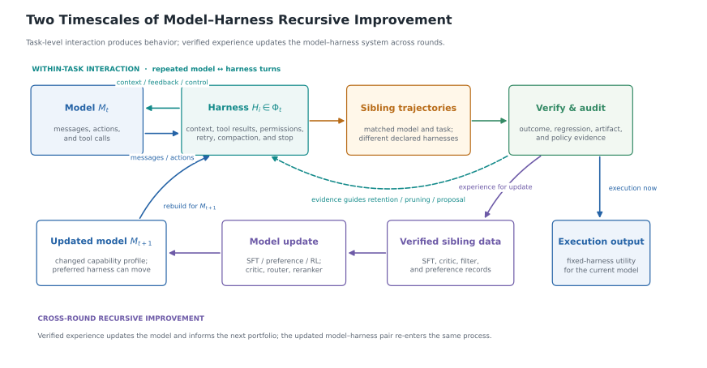

# HELIX: Model-Harness Co-evolution for Recursive Self-Improvement

> The University of Hong Kong · 2026-08-14 · paper · **闭环** · [论文](https://arxiv.org/abs/2608.13951) · [仓库](https://github.com/HKUDS/HELIX)
> 机制族：Harness 搜索与进化 · 来源核验 2026-10-15 · 复现状态 not-run

## Pipeline

两个耦合时间尺度：任务内由 harness 为固定模型中介上下文、工具结果、权限与控制流；跨轮则让一组演化出的 harness（65 个候选）在同一批任务上运行，已验证的同胞轨迹成为下一代模型的更新信号（SFT、critic、filter、preference 记录），更新后模型变化的能力画像再决定下一轮 harness 重建。HELIX 本体是一个可审计、可溯源的基座：把 agent 系统分解为类型化 ports/atoms/recipes/shells/policies，保留轨迹与出处。

*图源：Figure 1 (harness-model-coevolution.svg): two timescales of model-harness recursive improvement - within-task harness/model interaction above, verification-gated update and rebuild below*
## 结果（作者报告，非本地复现）

代码修复（SWE-bench）上：最佳固定 harness 比 Pi 多 4.0% 任务覆盖；65 候选完整组合通过互补的同胞行为多暴露至多 58.0% 的已验证覆盖；200 槽同胞切片产出 438 条已验证训练记录（SFT、critic、filter、preference）。

## 证据边界

主要数字核验到摘要层面；组合对单件的 58.0% 是覆盖暴露指标而非基准分数；展示的评测域仅为代码修复。

## 对 nanoRSI 的输入

已验证同胞切片的思路可直接映射到 nanoRSI 的冻结面板：每次闸门尝试（无论接受与否）都产出面板轨迹，可蒸馏为训练数据而非丢弃——证据账本已在记录它们。类型化 port 分解也是声明候选改动面的词汇表（ADOPTION 第 40 项的账本 schema）。

## 来源

[arXiv abstract](https://arxiv.org/abs/2608.13951) · [arXiv HTML v1](https://arxiv.org/html/2608.13951v1) · [HKUDS/HELIX (MIT)](https://github.com/HKUDS/HELIX)
