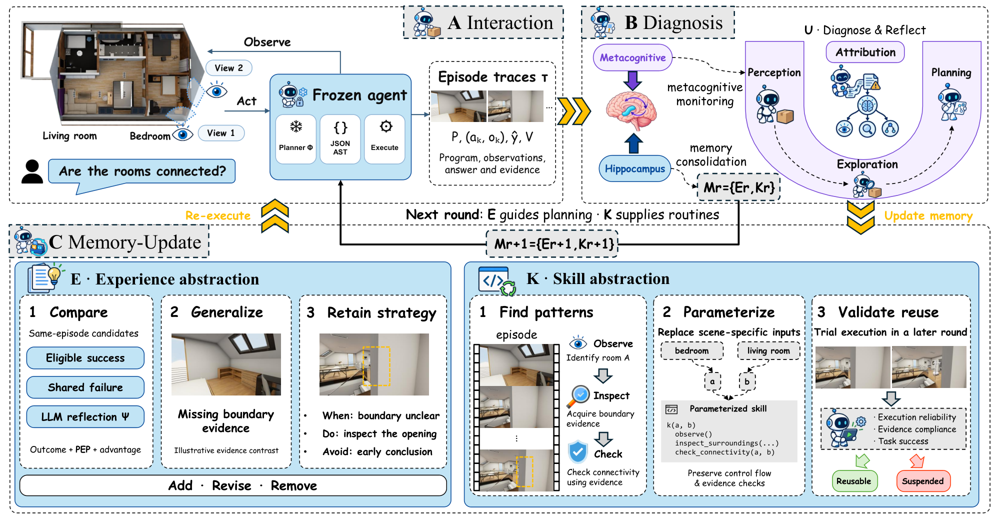

# Reflect After Failure: Brain-Inspired Self-Evolving Agents for Embodied Spatial Intelligence

> City University of Hong Kong / East China Normal University / University of Electronic Science and Technology of China / The Chinese University of Hong Kong, Shenzhen / The University of Hong Kong · 2026-10-14 · paper · **闭环** · [论文](https://arxiv.org/abs/2610.20312)
> 机制族：经验积累与回放 · 来源核验 2026-10-17 · 复现状态 not-run

## Pipeline

受脑启发的具身空间任务自进化智能体。海马-元认知反思在感知-探索-规划三轴上诊断失败——执行反馈本身很少揭示哪个环节负责，单纯堆积经验反而会强化无效策略。系统对比多次执行尝试提炼可复用策略与规避重复错误的指引，并用证据契约与基于执行的校验把交互程序抽象为参数化技能。

*图源：Figure 2 (Method.png), arXiv HTML 2610.20312v1*
## 结果（作者报告，非本地复现）

在具身空间基准上提升成功率并具泛化性（据摘要；本核验未重推逐表数字）。

## 证据边界

本核验侧重机制、机构与配图，未逐字提取结果数字；HTML 未找到代码链接。

## 对 nanoRSI 的输入

记忆沉淀前先做感知/探索/规划三轴归因，是我们“提案问题还是评测问题”归因的具身版：只有定位到失效环节后才写反思，否则累积的技能会强化错误修复。

## 来源

[arXiv abs 2610.20312](https://arxiv.org/abs/2610.20312) · [HTML full text v1](https://arxiv.org/html/2610.20312v1)
