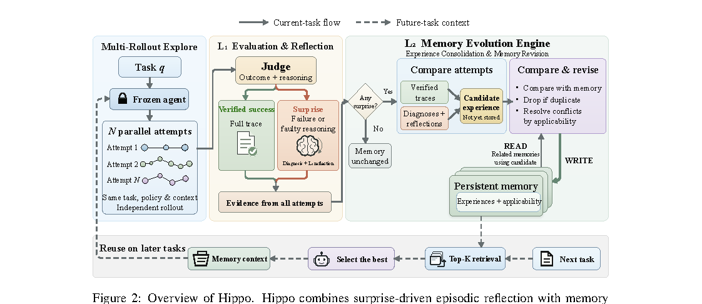

# Hippo: Training-Free Agent Self-Evolution via Hippocampal Replay

> University of California, Irvine / Rice University / Zillow Group · 2026-10-20 · paper · **闭环** · [论文](https://arxiv.org/abs/2610.24453)
> 机制族：经验积累与回放 · 来源核验 2026-10-21 · 复现状态 not-run

## Pipeline

显式以递归自改进为动机、经外部记忆的选择性编码与重放实现免训练自我演化。通过比较同任务多次尝试识别可复用决策并精炼其适用条件（错误推理可能碰巧成功；糟糕执行可能掩盖正确策略）；惊讶驱动的情景反思选择值得编码的内容；巩固阶段合并重叠、以显式适用条件解决冲突、就地修订既有指导而非为每条教训新增条目。

*图源：Figure 2 cropped from PDF page 4 (no HTML version exists); gs 150dpi render, bbox (77,99,1199,585)*
## 结果（作者报告，非本地复现）

在 SWE-bench Verified、WebArena、Mind2Web 上取得增益，且保留的经验条目远少于累积基线；增益跨不同能力的基座模型成立。无巩固的累积基线先升后降至低于无记忆基线（倒 U 型）——这是未巩固记忆库的头条负面证据。

## 证据边界

无参数更新（能力受冻结模型限制）；教训来自同任务配对尝试，成本随刻意重试增长；在三个既有套件上评估。

## 对 nanoRSI 的输入

用于技能/记忆线：把只增不减的教训清单换成显式适用条件下的就地修订巩固；凡经验库无修剪增长时，以倒 U 累积曲线作为常备诚实性检查。

## 来源

[arXiv abs 2610.24453](https://arxiv.org/abs/2610.24453) · [arXiv PDF (no HTML version)](https://arxiv.org/pdf/2610.24453)
