# Reef: Continual Learning Infrastructure for Self-Improving Agents

> Human-Agent-Society · 2026-09-01 · release · **闭环** · [论文](https://github.com/Human-Agent-Society/reef) · [仓库](https://github.com/Human-Agent-Society/reef)
> 机制族：反馈审查与编排 · 来源核验 2026-09-19 · 复现状态 not-run

## Pipeline

一个四阶段持续循环负责服务智能体请求、把后续反馈关联到交互 receipt、通过可配置 recipe 生成权重或 harness 候选，并在发布接受版本前执行选择策略。harness 路径无需本地训练 GPU 即可进化技能、规则、命令和扩展；被拒候选不会进入服务版本。公开 HTTP 接口兼容常见模型服务，并提供 scenario、receipt、report 与 release 操作。

*图源：README 'How it works' loop diagram*
## 结果（作者报告，非本地复现）

该发布提供可运行 quickstart 与 Reefine harness 演进教程，但没有为基础设施本身提供可比且独立审计的基准增益。核验时仓库页面显示约 2.4k GitHub stars、186 forks；PyPI 提供 Python 3.10+ 的 0.0.2 包。

## 证据边界

这是基础设施与发布文档，不是通用 RSI 或受控模型改进结果的证据。harness recipe 依赖外部模型端点及任务/评测配置；权重训练还依赖 GPU 栈。GitHub API 触发速率限制，无法新鲜读取 issue/PR 数字，因此仓库活动数量仅作为页面快照记录。

## 对 nanoRSI 的输入

把 Reef 作为 ADOPTION 18 的设计参照：保留 nanoRSI 的冻结评测器与 worktree 隔离，再把 receipt 关联反馈、候选版本历史、显式 pending/rejected 状态和窄范围 promote 步骤提升为一等对象。不要把 Reef 的服务商、GPU 或 Web 服务依赖引入 nanoRSI 的标准库核心。

## 来源

[Official repository README](https://github.com/Human-Agent-Society/reef) · [Apache-2.0 LICENSE](https://raw.githubusercontent.com/Human-Agent-Society/reef/main/LICENSE) · [PyPI reef-infra release history and metadata](https://pypi.org/project/reef-infra/) · [Reefine harness-evolution tutorial](https://github.com/Human-Agent-Society/reef/tree/main/tutorials/evolve-your-harness)
