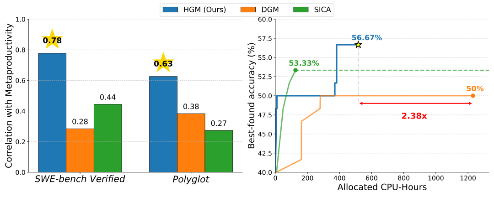

# Huxley-Gödel Machine: Human-Level Coding Agent Development by an Approximation of the Optimal Self-Improving Machine

> King Abdullah University of Science and Technology (KAUST) · 2025-10-24 · paper · **闭环** · [论文](https://arxiv.org/abs/2510.21614) · [仓库](https://github.com/metauto-ai/HGM)
> 机制族：自改写元智能体与谱系 · 来源核验 2026-10-15 · 复现状态 not-run

## Pipeline

编码 agent 编辑自身代码库，构建自修改树。论文识别出'元生产力-性能失配'——agent 的基准分数并不可靠指示其产出更强后代的能力——并提出 CMP（Clade Meta Productivity）：聚合一个 agent 全部后代的基准表现作为自改进潜力的指标。HGM 在线估计 CMP 并用它引导自修改树的搜索；论文证明在一定假设下，拥有真值 CMP 足以模拟 Gödel Machine 的行为。

*图源：Figure 1 (intro_figure_combined_wider.svg): left - the Metaproductivity-Performance Mismatch scatter (benchmark accuracy vs descendant gain); right - HGM's clade-level metric and compute efficiency*
## 结果（作者报告，非本地复现）

SWE-Verified-60（800 次评估、best-belief agent）：HGM 56.7（+16.7）对 DGM 53.3（+13.3）与 SICA 50.0（+10），CPU 时耗 517 小时对 DGM 1231（省 2.38 倍）；Polyglot 30.5（+10.2）对 27.1/25.4，347 小时对 2385（比 DGM 省 6.86 倍）。CMP 估计器与实现后代增益的加权相关性：SWE-Verified-60 0.778、Polyglot 0.626，对 DGM 0.285/0.383、SICA 0.444/0.274。完整 SWE-bench Verified 8000 次评估后达 61.4%（初始 agent 53.2%），当时排行榜最高的 GPT-5-mini 系统。迁移：GPT-5-mini 优化的 agent 换 GPT-5 评测 SWE-bench Lite 得 47.8%（filtered；SWE-agent 48.3%）与 57%（standard；56.7%）——匹配最佳官方核验的人工设计 agent。

## 证据边界

'当时排行榜最高'的断言会快速过时；CMP 相关性在加权评估子集上测得；论文 arXiv 许可为 CC BY-NC-SA（代码单独 Apache-2.0）。

## 对 nanoRSI 的输入

CMP 是 ADOPTION 第 38/39 项可实现的竞争选型器：按后代的聚合冻结面板表现（而非父代自身分数）给父代排名，可从既有 lineage store 直接计算、无需新增模型调用。'失配'发现对 nanoRSI 闸门也是直接警示：候选自身的面板分数对谱系价值只是噪声预测器。

## 来源

[arXiv abstract](https://arxiv.org/abs/2510.21614) · [arXiv HTML v3](https://arxiv.org/html/2510.21614v3) · [metauto-ai/HGM (Apache-2.0)](https://github.com/metauto-ai/HGM)
