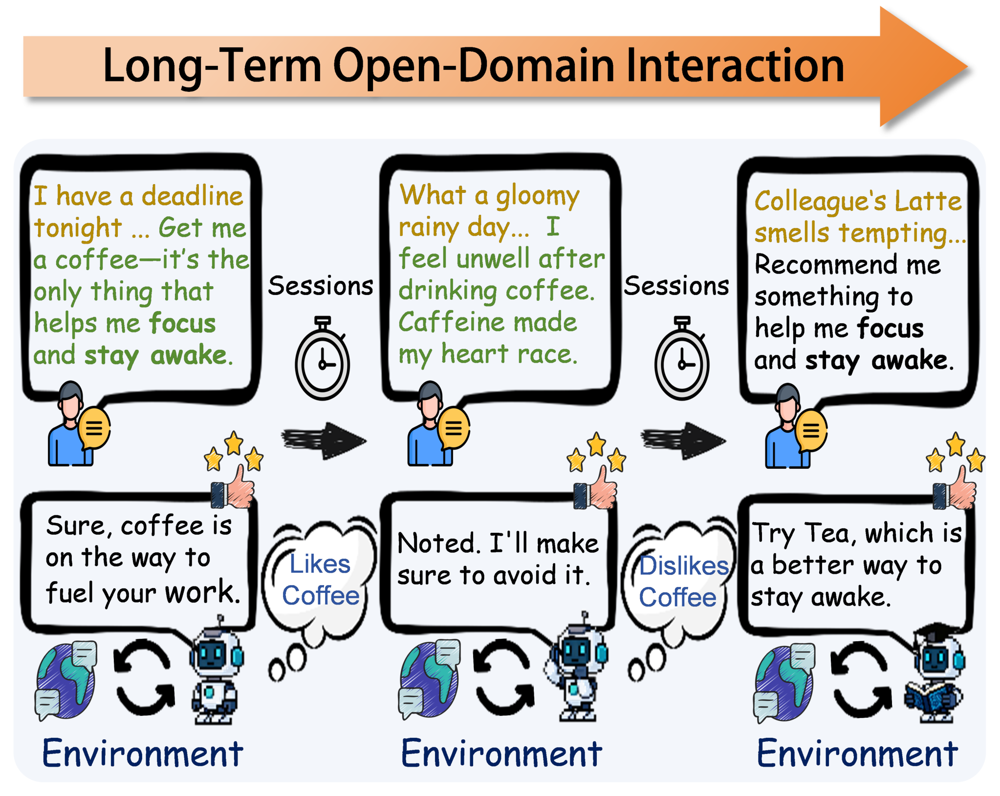

# Interactive Memory Learning for Long-Term Conversations

> Harbin Institute of Technology (Shenzhen) / Pengcheng Laboratory · 2026-09-15 · paper · **闭环** · [论文](https://arxiv.org/abs/2609.17088)
> 机制族：上下文组织策略 · 来源核验 2026-09-20 · 复现状态 not-run

## Pipeline

把记忆重新表述为可学习策略而非被动存储。会话合成管线构建专家数据用于快速适配；在线强化学习让 Planner（选择性编码高价值信息）与 Trigger（决定何时检索）共同演化；延迟奖励把未来交互反馈回传到更早的存储决策。

*图源：Figure 1 (fig1-7.png)*
## 结果（作者报告，非本地复现）

在 CC/MSC/GC 上，Llama3-Instruct 1B/3B/8B 版 Icml（另有 Gemma3 主干）优于 GPT-4o 长上下文（128K）与六个记忆基线（Mem0、A-Mem、MemoryOS、MemoryBank、LD-Agent、THEANINE）：如 CC BLEU-4 2.37（3B）对 GPT-4o 长上下文 1.79；GC BertScore 40.8 对 36.57；响应质量随交互累积持续提升。消融显示去掉合成数据、Planner、Trigger 或演化各有降分。

## 证据边界

仅 v1；未找到代码；生成代理指标而非下游任务结果；与 ThinkFlow 为同日姊妹篇，作者重叠。

## 对 nanoRSI 的输入

延迟奖励的归因方式可映射到 nanoRSI 技能保留：按下游 episode 结果而非当次闸门裁决给每个记忆/上下文提案打分。

## 来源

[arXiv abstract](https://arxiv.org/abs/2609.17088) · [arXiv HTML v1](https://arxiv.org/html/2609.17088v1)
