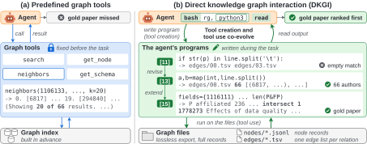

# Knowledge Graphs as Files: An Agent Harness Where Tool Creation and Tool Use Co-Evolve

> Texas A&M University / University of Oregon · 2026-10-13 · paper · **闭环** · [论文](https://arxiv.org/abs/2610.18616) · [仓库](https://github.com/leopoldwhite/DKGI)
> 机制族：技能文件优化与技能库 · 来源核验 2026-10-16 · 复现状态 not-run

## Pipeline

DKGI（直接知识图谱交互）把 KG 导出为文件——节点 JSONL 分片、按关系的 TSV 边表、schema.json、candidate_ids.txt——让编码 CLI（Pi 或 Codex）里的 ReAct 式代理把 shell 检索与直接在这些文件上写并执行 Python 交织，不用预定义图 API 或子图检索器。每回合代理可向工具箱 T_t 增加程序 p_t、向 L_t 增加保存的输出文件 l_t；执行反馈（候选 id、中间节点集、空匹配、报错信息，以及大输出的首尾截断视图）决定下一步的遍历、过滤或修订，使工具创造与工具使用在任务内共演化。复用有实测：48.4% 的程序嵌入早前输出中见过的节点 id；36.5% 修订早前程序（其中 88.6% 发生在失败之后）；更晚的程序读取早前的输出文件。

*图源：Figure 1 (S1.F1), arXiv HTML v1*
## 结果（作者报告，非本地复现）

免训练 DKGI 在 STaRK 合成测试（Amazon 1,642 / MAG 2,665 / Prime 2,801 查询）上：GPT-6-Astra 下对 GRASP（最强已训练基线）Hit@1 领先 +8.2 / +9.0 / +6.7——“每张图至少 6.7 Hit@1”；整体 H@1 71.5（Luna/Pi）、73.1（Luna/Codex）、82.1（Astra/Pi）。消融（测试子集，GPT-6-Luna）：完整 DKGI 75.2 对仅 shell 68.3、预定义图工具 72.8、图工具+代码 74.2、单程序 69.0、仅检索 47.7、无邻边 44.2——在原始文件上加 Python 得 +6.9，而在预定义图工具上只加 +1.4。

## 证据边界

范围：STaRK 三张 KG（≤10 实体类型、18 关系类型、190 万节点、3,980 万边）；Freebase/Wikidata 级 schema、聚合问题与同 harness 下的 Cypher/SPARQL 代理留作未来工作。仅用专有骨干（GPT-6-Luna/Astra，2026 年 9–10 月 API）；未测开源权重模型。基线数字取自文献、骨干/预算不一致；程序按查询丢弃；任意 shell 执行需沙箱。最大错误源是排序（答错案例中金节点被返回但未排第一的占 58/46/55%）；仅 shell 访问甚至不如预定义图工具。

## 对 nanoRSI 的输入

共演化的度量即可迁移点：给 nanoRSI 技能演化装上统计——“新程序中复用早前输出（嵌入 id）的比例、修订早前程序的比例、修订中有多少发生在失败之后”——这些按轨迹的廉价统计能区分真实积累与重新推导。消融还支持把任务数据以原始文件而非预定义工具 API 交给代理：直接文件访问加代码的收益超过任一单独形式。

## 来源

[arXiv abstract](https://arxiv.org/abs/2610.18616) · [arXiv HTML v1](https://arxiv.org/html/2610.18616v1) · [DKGI code](https://github.com/leopoldwhite/DKGI)
