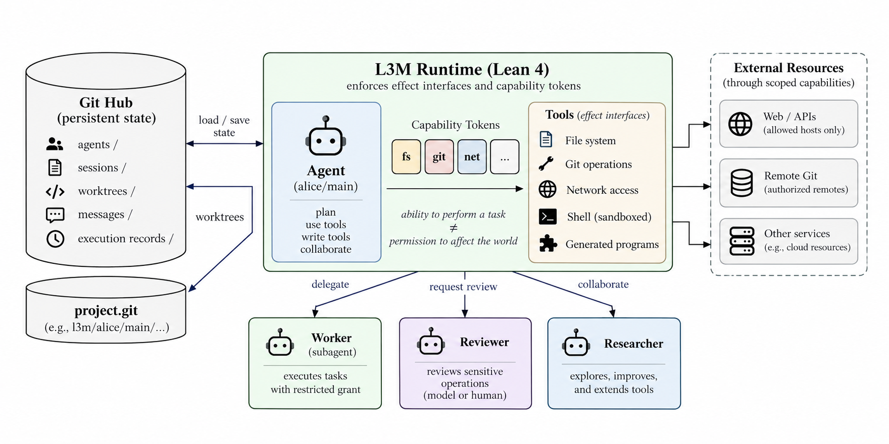

# L3M: A Verifiable Harness and Runtime for Self-Extending and Self-Improving Agents

> Amazon · 2026-10-14 · paper · **闭环** · [论文](https://arxiv.org/abs/2610.19591)
> 机制族：安全与治理 · 来源核验 2026-10-16 · 复现状态 not-run

## Pipeline

以 Lean 4 写成的运行时：同一种语言实现 harness、陈述其不变量，也是代理扩展它的语言。全部状态存放于 Git：丰富的状态轨迹——而非聊天会话——是运行时可恢复、回滚、分叉、比较与合并的对象；等待、通信、委派与撤销是原语而非每次重新推理的模式。当代理摸索出一个过程，可将其一次性写成密封的 Lean 程序，其类型即权限请求，harness 再把它作为工具提供回来。可逆性决定安全边界：工具的审查层级取决于其影响能被撤销多远，运行时能恢复之处代理可自由行动；可能被链成攻击的职责由不同方分掌，而使这一切安全的性质以内核检查的定理形式陈述在运行的代码上。

*图源：Figure 1 (main overview), arXiv HTML v1*
## 结果（作者报告，非本地复现）

在 Terminal-Bench 上对照 Claude Code、以普通受限代理运行：未调优的 L3M“驯化”臂（无野调用）pass@3 27.0%，同 harness 开 shell 且关审查为 41.7%（34 对 18 通过，表 5）——无任何未审查调用即达 shell 三分之二；驯化臂 18 次通过中有 5 次用了代理自写的工具程序。驯化与 shell 两臂每次通过的 token 开销相当，指向差距来自 harness 而非权限约束。

## 证据边界

作者自述：结果来自未调优 harness，调优后通过率与 token 成本预计改善（安全定理不依赖调优）；“三分之二”仅限这些 Terminal-Bench 任务；评测是对 Claude Code 的初步评测。截至 2026-10-16 HTML 未声明公开代码发布。

## 对 nanoRSI 的输入

两个迁移点：(i) 按可逆性分层审查——nanoRSI 闸门严格度可随“影响可撤销距离”走（干跑与纯增量编辑自动放行、破坏性或改状态编辑走反事实复审），而非一刀切；(ii) 密封过程类型——候选技能被接受时连同显式能力声明（可读/写/执行什么）一起冻结并由执行器强制，让技能文件的权限面可机检。

## 来源

[arXiv abstract](https://arxiv.org/abs/2610.19591) · [arXiv HTML v1](https://arxiv.org/html/2610.19591v1)
