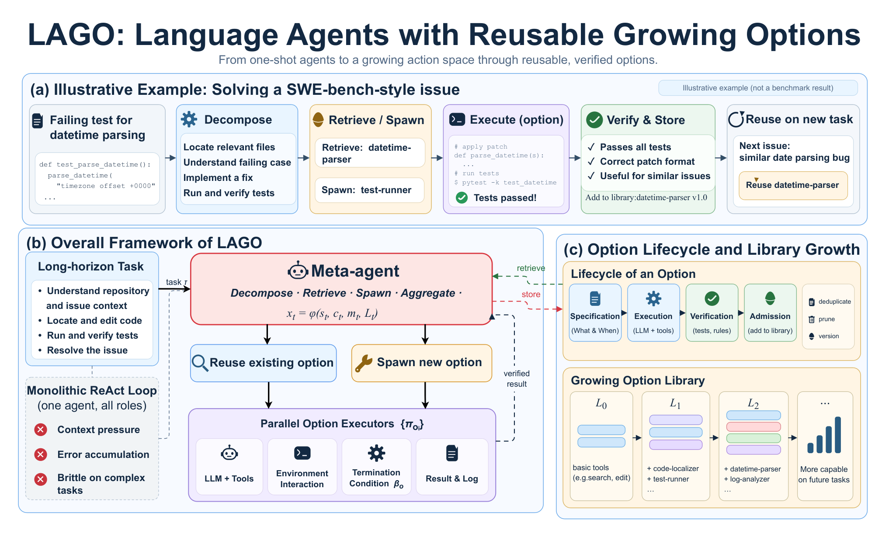

# LAGO: Language Agents with Reusable Growing Options

> Shenzhen University / University of Hong Kong / Hunan University / National University of Singapore / Evolvent Research Team 等 · 2026-10-14 · paper · **闭环** · [论文](https://arxiv.org/abs/2610.19843)
> 机制族：程序进化与进化搜索 · 来源核验 2026-10-17 · 复现状态 not-run

## Pipeline

把专门化语言智能体当作可复用的时间扩展选项：元智能体从持久库检索选项或新生选项、派发子任务、验证结果、把成功的新选项准入库；库跨任务增长而不更新模型权重。

*图源：Figure 1 (LAGO_editable_no_footer.drawio.png), arXiv HTML 2610.19843v1*
## 结果（作者报告，非本地复现）

在 500 个 SWE-bench Verified 任务上以官方 Docker 评测器单次尝试评测，冻结 Qwen3.5-35B-A3B 同时担任元智能体与选项角色解决 58.6%。在固定 150 任务受控子集（同策略、同温度、同任务 ID、同评测器）：mini-SWE-agent 49.3%、Terminus 2 57.3%、LAGO 60.3%。50 任务组件消融：去掉分解少解 4 题、复用内容乱序少 2 题、去掉库少 6 题。跨模型实验与“分解质量有作用”的解释一致。

## 证据边界

未找到代码链接；元智能体与选项共用同一冻结模型（能力上限受约束）；受控对比只覆盖 500 任务中的 150 个。

## 对 nanoRSI 的输入

选项准入（生成→验证→准入→复用）正是技能模板可以镜像的库增长环：经验证的子智能体程序成为一等可复用单元而非一次性轨迹。“去掉库少解 6 题”的消融量化了冻结模型上持久库的价值——这是 nanoRSI 任何技能库变体要打败的数字。

## 来源

[arXiv abs 2610.19843](https://arxiv.org/abs/2610.19843) · [HTML full text v1](https://arxiv.org/html/2610.19843v1)
