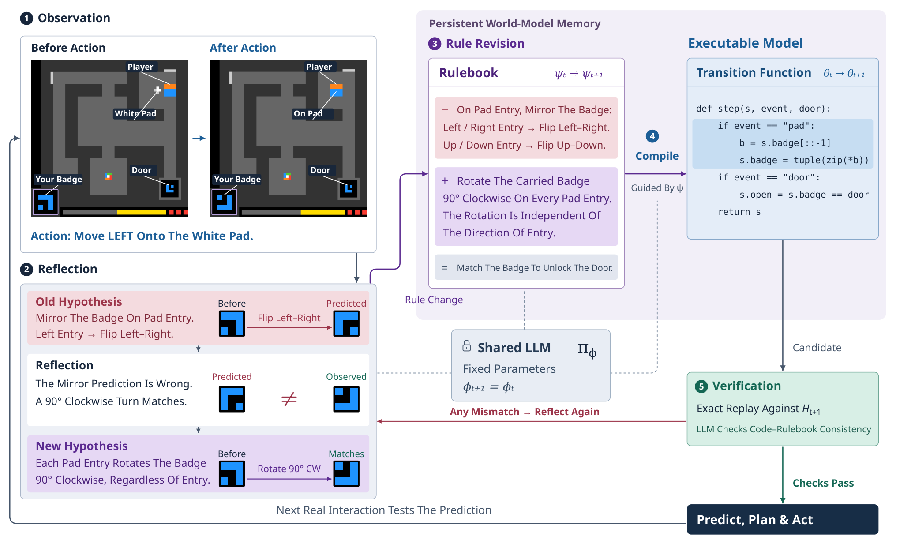

# Memento 3: Model-Based Recursive Self-Improvement through Reflective Rulebooks

> University College London / Huawei Noah's Ark Lab / University of Liverpool · 2026-10-08 · paper · **闭环** · [论文](https://arxiv.org/abs/2610.11794)
> 机制族：结构化知识库与图 · 来源核验 2026-10-13 · 复现状态 not-run

## Pipeline

冻结参数的 LLM agent 维护显式世界模型：以自然语言规则书承载关于环境动力学的可修订假设，作为持久语义记忆。观察-反思-规则修订-编译-校验的持续循环把规则书编译为可执行代码用于预测与规划；只有当 LLM 判定更新忠实且逐格重放复现观测转移时才接受。种群扩展维护多个平行世界模型以对抗自我确认假设。

*图源：Figure 2 (codeasmodel-overview.png): the continual loop of observation, reflection, rule revision, compilation and verification around a frozen LLM*
## 结果（作者报告，非本地复现）

在 ARC-AGI-3 全部 25 个公开游戏上（Claude Opus 5，推理力度 extra-high），agent 清空 25 局全部 183 关，平均 RHAE 100.0，共 7,518 步动作为人类基线 17,135 步的 0.44 倍（逐局比值 0.20-0.67，中位 0.42），比同一模型在 ARC Prize Standard harness 上高 59.3 平均 RHAE；列出的基线：baseline1 harness 99.0、NOOA 85.1、OPINE-World 78.4、DreamTeam 38.1、Continual Harness 20.5。三局规则书消融：动作 -9%、agent 轮次 -18%。双世界模型种群在一局上把动作从 899 降到 597。以此学出的 Pong 控制器在三局内 21:0 全胜（9,504 帧模拟器帧），执行期零 LLM 调用；对照 GDI/LASER 约 2e8 帧到 21、EfficientZero-V2 4e5 帧到 20.8、同一 LLM 无世界模型得 -19。

## 证据边界

有限交互历史容许多个一致的世界模型（变体空间歧义）——重放能拒绝不一致的程序，但无法在一致候选中挑出正确规则；单一承诺假设可能自我确认；规则书忠实性是 LLM 判定的语义条件而非精确检查；ARC-AGI-3 每次运行时间与金钱成本高，消融只覆盖三局；作者注明公开集随模型变强趋于饱和，仅凭通关无法分离架构贡献。

## 对 nanoRSI 的输入

对 nanoRSI 技能可移植的是其接受规则：技能/世界模型编辑只有在已记录 episode 的精确重放复现观测转移时才准入——在 LLM judge 之上叠加确定性重执行检查，与既有证据账本及反事实面板兼容。世界模型种群的思想对应维护多个技能假设而非承诺单一修订技能。

## 来源

[arXiv abstract](https://arxiv.org/abs/2610.11794) · [arXiv HTML v1](https://arxiv.org/html/2610.11794v1)
