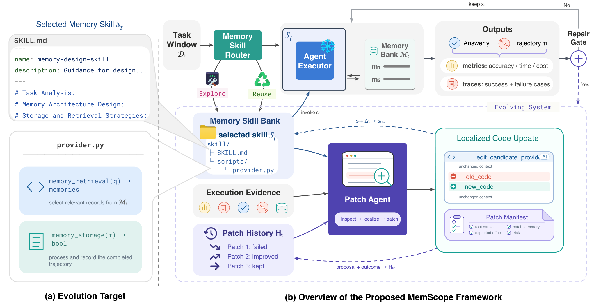

# MemScope: Evolving Agent Memory Architectures through Localized Code Repair

> Institute of Computing Technology, Chinese Academy of Sciences / University of Chinese Academy of Sciences / Meituan · 2026-10-15 · paper · **闭环** · [论文](https://arxiv.org/abs/2610.21170)
> 机制族：记忆进化评测研究 · 来源核验 2026-10-19 · 复现状态 not-run

## Pipeline

记忆按 Agent Skills 形态打包（必备 SKILL.md 与 scripts/ 下可执行 provider，激活的 provider 维护自己的运行时记忆库）。会工具使用的 Patch Agent 联合检查原始执行轨迹、运行时记忆状态、当前 provider 代码与补丁历史，定位修复目标，并在 provider 身份不变与记忆兼容约束下施加有界的就地编辑——替换部件而非重写架构；每个补丁及其后续结果被记录用于后续演化。

*图源：Figure 2 (method.png), arXiv HTML 2610.21170v1*
## 结果（作者报告，非本地复现）

GAIA 诊断性消融：轨迹+记忆联合检查 86.67%，对纯轨迹 70.00% 与纯摘要 63.33%。匹配的顺序在线评测（MemEvolve 协议）下：xBench 用 DeepSeek V3.2 由 49 提升至 55、Kimi K2.7 Code 由 50 提升至 53；GAIA 83.64%、xBench 78%，对 MemEvolve + Flash-Searcher 的 67.88%/70%（DeepSeek V3.2）；ALFWorld 未见任务 50.75%→71.64%。归档架构快照间迁移的中位代码改动比例 4.4%。

## 证据边界

演化的记忆技能库由 12 个人工设计的 MemEvolve/EvolveLab 技能初始化，增益是在继承设计之上测得的；局部性由补丁约束强制，而非证明定位区域即真实故障；评测遵循顺序在线协议，xBench/ALFWorld 上代码跨episode持久而记忆每episode重置，属特定可比性制度。

## 对 nanoRSI 的输入

证据接地的定位是 nanoRSI 的提案接口纪律：让提案者同时看到执行轨迹、其产出的运行时状态、目标代码与既往补丁结果，要求附带补丁清单（定位故障、预期范围）的有界就地编辑而非整文件重写；4.4% 的中位改动比例是“局部化”应有的已发表参考点。

## 来源

[arXiv abs 2610.21170](https://arxiv.org/abs/2610.21170) · [arXiv HTML v1](https://arxiv.org/html/2610.21170v1)
