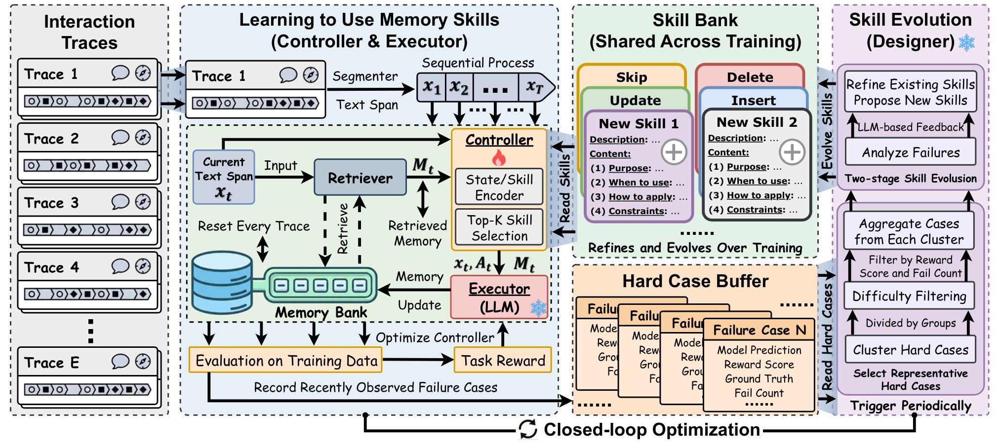

# MemSkill: Learning and Evolving Memory Skills for Self-Evolving Agents

> Nanyang Technological University / University of Illinois Urbana-Champaign / University of Illinois Chicago / Tsinghua University · 2026-02-02 · paper · **闭环** · [论文](https://arxiv.org/abs/2602.02474) · [仓库](https://github.com/ViktorAxelsen/MemSkill)
> 机制族：结构化知识库与图 · 来源核验 2026-09-16 · 复现状态 not-run

## Pipeline

记忆抽取操作成为可学习的'记忆技能'，双环交织。技能选择/使用：轻量控制器（状态-技能嵌入上的 MLP，Gumbel-Top-K 采样）逐文本 span 选 Top-K 技能子集，LLM 执行器按技能更新该轨迹记忆库，控制器以下游问答表现为 PPO 奖励训练。技能进化：滑动难例缓冲记录以查询为中心的失败；每 100 步设计者 LLM 聚类难例、精炼/新增技能（每轮最多 3 次编辑），配快照回滚、早停与新技能探索偏置。

*图源：Figure 2*
## 结果（作者报告，非本地复现）

LoCoMo（LLaMA3.3-70B）：F1 44.21 / L-J 53.82 对 MemoryOS 41.39、A-MEM 49.71；迁移到 LongMemEval（L-J 60.89）与 HotpotQA（50/100/200 文档全部最优）；ALFWorld seen/unseen 77.14/83.58 成功率（均值 80.36）胜 Mem0 与 CoN；AppWorld 26.71% 对 AWM 25.42%。消融：去控制器 L-J -5.4，去技能描述（Qwen）-17.7。成本：215 次 LLM 调用对 MemoryOS 1,288、A-MEM 1,548。

## 证据边界

局限性在附录 F（HTML 审阅未渲染）；LongMemEval 与 Qwen 行为纯迁移（在 LoCoMo+LLaMA 上训练）；技能进化的准备成本是摊销而非免费。

## 对 nanoRSI 的输入

对 nanoRSI：进化'写记忆的操作'本身（而不止记忆内容），并用快照回滚 + 早停闸门约束设计者编辑——与技能轨相同的控制，再高一层。

## 来源

[arXiv abstract](https://arxiv.org/abs/2602.02474) · [Paper v2 (affiliations, Figure 2, tables)](https://arxiv.org/html/2602.02474v2) · [Code repository (Apache-2.0)](https://github.com/ViktorAxelsen/MemSkill)
