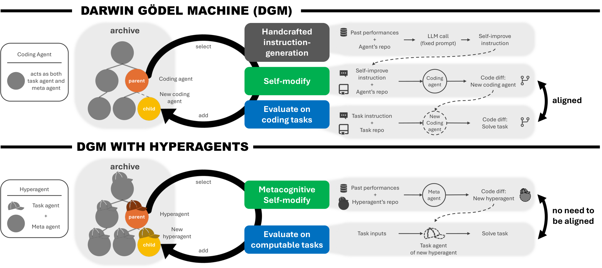

# Hyperagents

> Meta / University of British Columbia · 2026-03-19 · paper · **闭环** · [论文](https://arxiv.org/abs/2603.19461) · [仓库](https://github.com/facebookresearch/HyperAgents)
> 机制族：自改写元智能体与谱系 · 来源核验 2026-09-16 · 复现状态 not-run

## Pipeline

可编辑的元智能体修改自身及任务智能体；经评价的有效变体进入档案，作为后续父代和反馈来源，入库不要求立即提高分数。

*图源：Figure 1*
## 结果（作者报告，非本地复现）

100轮后，论文评审保留集准确率为0.710（置信区间0.590–0.750），静态基线为0.630、定制DGM为0.590。与定制DGM的差异不显著；初始0.0源于输出格式失败。

## 证据边界

基础模型和评价器固定，有限轮次实验不能证明无限自我加速。

## 对 nanoRSI 的输入

建议实验：分别管理任务代码和元代码版本，保留已评价的中间变体及不可变评价记录。

## 来源

[Paper history](https://arxiv.org/abs/2603.19461) · [Paper v1, authors and section 5.1](https://arxiv.org/html/2603.19461v1) · [Meta publication](https://ai.meta.com/research/publications/hyperagents/) · [Official code](https://github.com/facebookresearch/HyperAgents) · [Code licence](https://github.com/facebookresearch/HyperAgents/blob/main/LICENSE.md)
