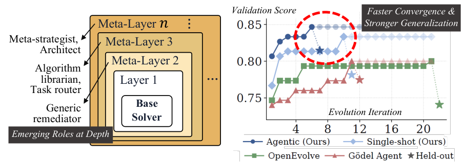

# Meta^n: Recursive Self-Improvement through Emergent Depth

> University of Minnesota / Seoul National University · 2026-08 · paper · **闭环** · [论文](https://arxiv.org/abs/2608.24735) · [仓库](https://github.com/minnesotanlp/meta-n)
> 机制族：自改写元智能体与谱系 · 来源核验 2026-09-16 · 复现状态 not-run

## Pipeline

单一固定的元操作 Omega 反复作用于自身输出：每次调用读取下层的轨迹与（自第 3 层起）其产出的代码，再写出下一层代码（预处理器 + 代码库）；包装器复合成 Sd = Md o ... o M2 o S1。深度持续增长直到 Omega 不再找到改进（收敛阈值 0.02），并有跨链进化档案；各层角色无提示地涌现（回滚行为首次出现在第 3 层）。

*图源：Figure 1*
## 结果（作者报告，非本地复现）

八个基准家族上实测元深度 3-6（平台期 3-4；材料科学 SR 达 6），而既有自改写系统实测上限约 2.5。ARC-AGI-2：0.331 +/- 0.010 对 OpenEvolve 0.003、Godel Agent 0.054——唯一能解出任意任务的系统；CO-Bench（GPT-5.2）0.870 对 0.702。消融去递归：-0.131（Gemma CO）；层间上下文贡献约 72% 增益。

## 证据边界

所有层用同一模型（更强的 Omega 配更弱基座未测）；层间上下文是自由文本；高层推理能力与累积层代码的上下文饱和仍是未测上界。

## 对 nanoRSI 的输入

对 nanoRSI：把'实测元深度'（在平台期前真正有效的嵌套改进层数）作为标准报告字段——Meta^n 证明它可测量，而自改写环要打败的基线约为 2.5。

## 来源

[arXiv abstract](https://arxiv.org/abs/2608.24735) · [Paper v1 (affiliations, Figures 1-3, tables)](https://arxiv.org/html/2608.24735v1) · [Code repository (MIT)](https://github.com/minnesotanlp/meta-n)
