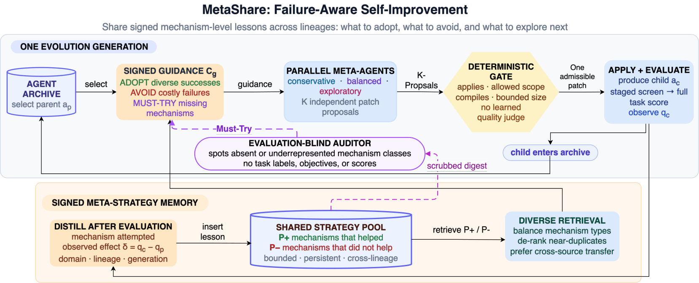

# MetaShare: Failure-Aware Collective Self-Improvement for Open-Ended Agents

> PricewaterhouseCoopers (PwC) · 2026-10-15 · paper · **闭环** · [论文](https://arxiv.org/abs/2610.21887)
> 机制族：自改写元智能体与谱系 · 来源核验 2026-10-19 · 复现状态 not-run

## Pipeline

每次被评测的智能体修改都成为一条带符号的记录（有帮助→复用，有损害→规避），存入有界的跨谱系池。每代生成前，失败感知的多样性检索重建“采纳/规避/必试”引导上下文；K 个元智能体以异构温度并行提案，经确定性的四轴准入闸门录取其一。任务盲审计器定期从脱敏摘要中注入缺失或代表性不足的机制类别；基于嵌入的去冗余排序限制检索重复。

*图源：Figure 2 (arch.png), arXiv HTML 2610.21887v1*
## 结果（作者报告，非本地复现）

对 DGM-H（五次运行取中位数、95% bootstrap 置信区间）：论文评审 0.71→0.79、Polyglot 全量 225 任务 0.28→0.34、机器人奖励设计 0.37→0.40、三个 IMO 评分设置 0.61/0.64/0.60→0.64/0.70/0.67、审计风险 0.45→0.55，同时最优检查点出现代数下降 1.7–2.9 倍（论文评审 100→36、审计风险 44→26）。Polyglot 小/中集：五次运行 0.912 [0.902, 0.922]、10 次迭代内，对 GEA 单次运行 0.88——作者自述为更低迭代数下的竞争性而非同类对比胜利。消融：把真实失败记录换成长度匹配的打乱失败损失 0.07（语义而非 token）；移除任务盲审计器损失 0.15；算力匹配参照（k=3 时关闭池）分离出记忆层 +0.11 验证精度与少 19 代；审计器可复现地解锁动态模型选择（o3-mini→GPT-4o-mini），而拥有相同动作空间的 DGM-H 从未提出。

## 证据边界

论文评审、机器人与 IMO 上的 DGM-H 数字取自 Zhang et al. (2026) 报告值而非重跑，故这些域上两臂的准入闸门未保持一致；k=3 消耗约 3 倍自修改 token（是质量与速度主张，非 token 效率）；NMAE 在两个域回退（IMO-full 0.175 对 0.157、审计风险 0.357 对 0.312）；与 GEA 的对比是五次运行区间对单点估计。

## 对 nanoRSI 的输入

带打乱失败对照的符号化失败账本可直接移植到 nanoRSI 的 rejected_recent 池：按提案存储带符号增益，引导提案器时作为规避信号检索，并跑长度匹配的打乱拒绝对照臂，证明账本承载语义而非 token；任务盲“必试”注入是防止提案流塌缩到冗余编辑的多样性机制。

## 来源

[arXiv abs 2610.21887](https://arxiv.org/abs/2610.21887) · [arXiv HTML v1](https://arxiv.org/html/2610.21887v1)
