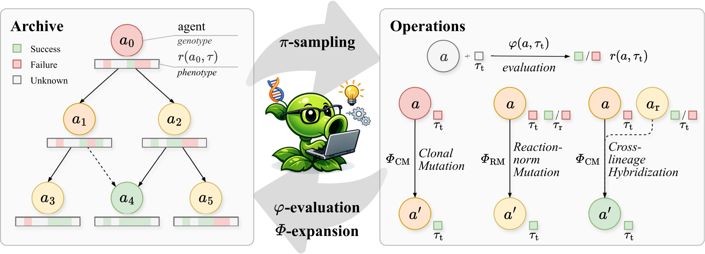

# Mendel Gödel Machine: Recursive Self-Improving Coding Agents via Comparative Evolution

> University of Electronic Science and Technology of China / Ludwig Maximilian University of Munich / Munich Center for Machine Learning · 2026-08 · paper · **闭环** · [论文](https://arxiv.org/abs/2608.07645) · [仓库](https://github.com/RealLcz/MGM)
> 机制族：自改写元智能体与谱系 · 来源核验 2026-09-21 · 复现状态 not-run

## Pipeline

在档案式自修改（DGM/HGM）上加入三个由比较证据驱动的孟德尔算子：克隆变异（单轨迹编辑）、反应规范变异（用同一智能体跨多任务的轨迹编辑——复现失败标记基因型缺陷）、跨谱系杂交（从另一谱系的成功轨迹提取可迁移行为性状并适配，不拼接代码）。失败任务池提高采样权重使谱系在难题上重叠。命题 1：加性适应度地形下，比较证据提升修复概率。

*图源：Figure 1*
## 结果（作者报告，非本地复现）

Qwen3.6-35B-A3B、200 次评估 + 24 次扩展：SWE-bench Verified-60 68.3% -> 78.3%（HGM 73.3%）；Polyglot-60 50.8% -> 93.2%（HGM 77.9%）；完整 Polyglot-225 达 93.3%，'以约 117 倍少的参数超过闭源 GPT-5'。跨基准迁移：SWE-bench Pro 16.7% -> 26.7%；Multilingual 41.7% -> 55.0%。跨模型迁移：DeepSeek-V4-Flash 50.0% -> 66.7%、V4-Pro 45.0% -> 75.0%。

## 证据边界

高时间/GPU 成本限制了种子数与扫参；算子需要多轨迹历史与跨谱系任务重叠（档案小时退化为单轨迹基线）；编辑质量无保证；结论限于公开基准上的编码智能体脚手架。

## 对 nanoRSI 的输入

对 nanoRSI：按谱系保存逐任务轨迹，并允许由跨任务复现失败（反应规范）与其他候选在共享任务上的成功（杂交）驱动的编辑——都是候选分数之外的选择信号。

## 来源

[arXiv abstract](https://arxiv.org/abs/2608.07645) · [Paper v1 (affiliations, Figure 1, results tables)](https://arxiv.org/html/2608.07645v1) · [Code repository (Apache-2.0)](https://github.com/RealLcz/MGM)
