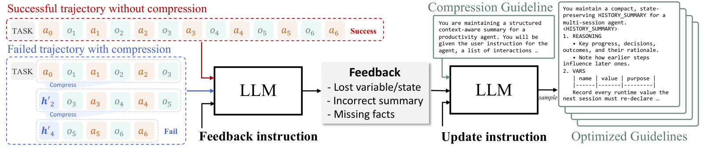

# ACON: Optimizing Context Compression for Long-horizon LLM Agents

> Microsoft / KAIST / University of Cambridge · 2025-10-01 · paper · **闭环** · [论文](https://arxiv.org/abs/2510.00615) · [仓库](https://github.com/microsoft/acon)
> 机制族：上下文组织策略 · 来源核验 2026-09-13 · 复现状态 not-run

## Pipeline

LLM比较完整上下文成功、压缩上下文失败的配对轨迹，修改压缩指南并评价候选指南；选择结果用于后续优化轮次，基础智能体权重保持固定。

*图源：Figure 3*
## 结果（作者报告，非本地复现）

OfficeBench采用GPT-4.1作为智能体和压缩器：效用优化的历史压缩取得74.74%准确率和4.93k峰值令牌；无压缩为76.84%/7.27k，简单提示压缩为71.58%/4.40k（v1表2）。

## 证据边界

属于有限的离线模块优化；准确率与令牌开销的取舍不等于普遍提高准确率，也不是优化器重写自身。

## 对 nanoRSI 的输入

建议实验：根据配对失败优化压缩提示，保留独立验证集，同时记录成功率和上下文峰值。

## 来源

[Paper history](https://arxiv.org/abs/2510.00615) · [Paper v1](https://arxiv.org/html/2510.00615v1) · [Official Microsoft code](https://github.com/microsoft/acon) · [MIT licence](https://github.com/microsoft/acon/blob/main/LICENSE)
