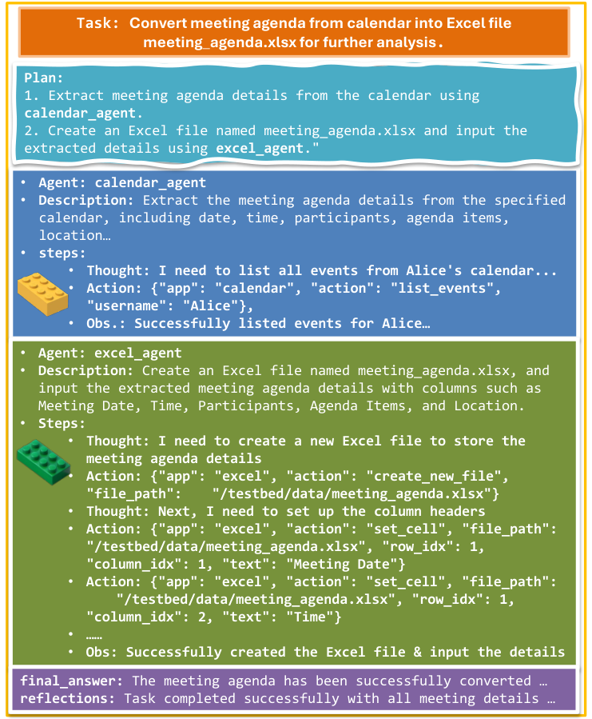

# LEGOMem: Modular Procedural Memory for Multi-agent LLM Systems for Workflow Automation

> Microsoft · 2025-10-06 · paper · **支撑·无闭环** · [论文](https://arxiv.org/abs/2510.04851)
> 机制族：上下文组织策略 · 来源核验 2026-09-13 · 复现状态 not-run

## Pipeline

成功日志转为完整任务规划记忆和角色专用子任务记忆，后续任务检索复用。实验先离线建库再评价推理，并未测试持续在线记忆演化。

*图源：Figure 1*
## 结果（作者报告，非本地复现）

OfficeBench采用148个训练任务、152个测试任务和三个随机种子：GPT-4o成功率58.44%，无记忆为45.83%；GPT-4o-mini为38.16%，无记忆为24.78%。Synapse配GPT-4o达58.11%，因此该设置中相对强基线的优势很小。

## 证据边界

支持程序性记忆复用，未展示多轮递归自我改进；记忆筛选和外部模型依赖会影响结论。

## 对 nanoRSI 的输入

建议实验：比较经成功筛选的程序记忆与无记忆基线，区分规划和子任务检索，并冻结测试记忆库。

## 来源

[Paper history](https://arxiv.org/abs/2510.04851) · [Paper v1, method and Table 1](https://arxiv.org/html/2510.04851v1) · [Microsoft Research publication](https://www.microsoft.com/en-us/research/publication/legomem-modular-procedural-memory-for-multi-agent-llm-systems-for-workflow-automation/)
