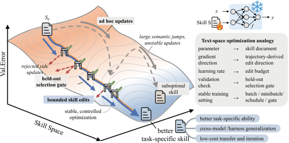

# SkillOpt: Executive Strategy for Self-Evolving Agent Skills

> Microsoft Research · 2026-06-30 · report · **闭环** · [论文](https://www.microsoft.com/en-us/research/blog/skillopt-agent-skills-as-trainable-parameters/) · [仓库](https://github.com/microsoft/SkillOpt)
> 机制族：技能文件优化与技能库 · 来源核验 2026-09-14 · 复现状态 not-run

## Pipeline

把 agent 的技能文件当作文本空间中的可训练参数：优化器模型在前向–反向–更新循环中提出有界编辑，候选技能"只有在留出验证集上严格优于当前技能时才被采纳"；被拒编辑进入缓冲区作为负反馈，其上还有按 epoch 的慢速/元更新。

*图源：Blog Figure 1*
## 结果（作者报告，非本地复现）

作者报告：在全部 52 个评测单元（6 基准 × 7 模型 × 3 执行模式）中相对人工技能、单次 LLM 技能、Trace2Skill、TextGrad、GEPA、EvoSkill 取得最优或并列最优；GPT-5.5 直聊下六基准平均从 58.8 升至 82.3（绝对 +23.5 分）；SpreadsheetBench 41.8→80.7；在 Codex 中训练的表格技能把 Claude Code 从 22.1 提到 81.8（+59.7）；最终技能中位约 920 token、仅 1–4 次被采纳编辑；去掉元技能/慢更新后 SpreadsheetBench 从 77.5 跌至 55.0。

## 证据边界

技能优化由固定基准内的留出验证监督——闭环是在已知测试分布上优化，未证明分布外或套件外任务的收益；跨 harness 迁移只展示了一个技能族；执行模式依赖未固定版本的商业 harness。

## 对 nanoRSI 的输入

建议：在 nanoRSI 的技能面上增加"留出闸门"技能编辑器——只在严格验证提升时采纳有界 diff 提案——与无闸门自编辑及冻结技能在相同任务流上对比，记录编辑采纳率与回归。

## 来源

[Official MSR blog post (opened)](https://www.microsoft.com/en-us/research/blog/skillopt-agent-skills-as-trainable-parameters/) · [Official implementation (MIT)](https://github.com/microsoft/SkillOpt) · [Publication page](https://www.microsoft.com/en-us/research/publication/skillopt-executive-strategy-for-self-evolving-agent-skills/)
