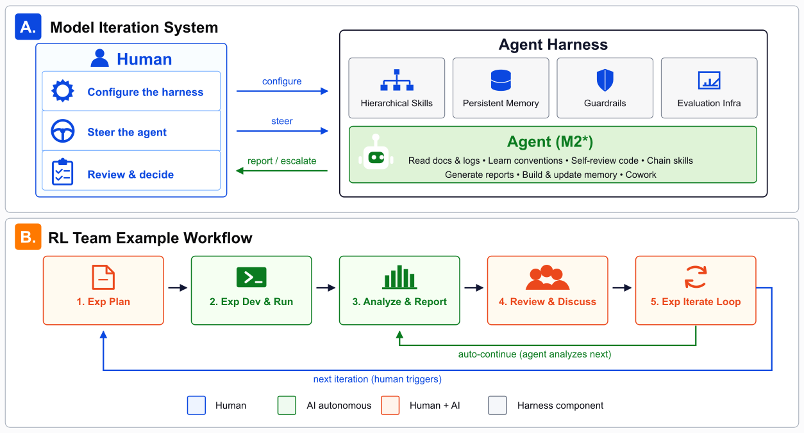

# MiniMax M2.7: Early Echoes of Self-Evolution

> MiniMax · 2026-03-18 · report · **闭环** · [论文](https://arxiv.org/abs/2605.26494) · [仓库](https://huggingface.co/MiniMaxAI/MiniMax-M2.7)
> 机制族：Harness 搜索与进化 · 来源核验 2026-09-13 · 复现状态 not-run

## Pipeline

内部 M2.7 智能体分析失败轨迹，修改 scaffold 代码及采样配置，评测后保留或回滚，并用于下一轮。另一个研发流程更新记忆/技能、辅助研究员开展 RL 实验，但仍由人提供方向并作关键决策。

*图源：Figure 8*
## 结果（作者报告，非本地复现）

MiniMax 报告进行了超过 100 轮自主 scaffold 迭代，内部编程评测提升 30%；未披露绝对基线、评测集身份及不确定性，因此不能独立横向比较。

## 证据边界

这是第一方内部实验，尚非复现结果；辅助模型研发与 scaffold 自改不证明完全自主的后继模型训练。

## 对 nanoRSI 的输入

拟议 nanoRSI coding 实验：将修改限制在 scaffold 文件，冻结执行模型，在隐藏测试集上审计保留/回滚决策。

## 来源

[Official M2.7 report](https://www.minimax.io/news/minimax-m27-en) · [Related M2-series technical paper dates](https://arxiv.org/abs/2605.26494) · [Related M2-series paper v1](https://arxiv.org/html/2605.26494v1) · [Official M2.7 model](https://huggingface.co/MiniMaxAI/MiniMax-M2.7) · [Current M2.7 non-commercial license](https://huggingface.co/MiniMaxAI/MiniMax-M2.7/blob/main/LICENSE)
