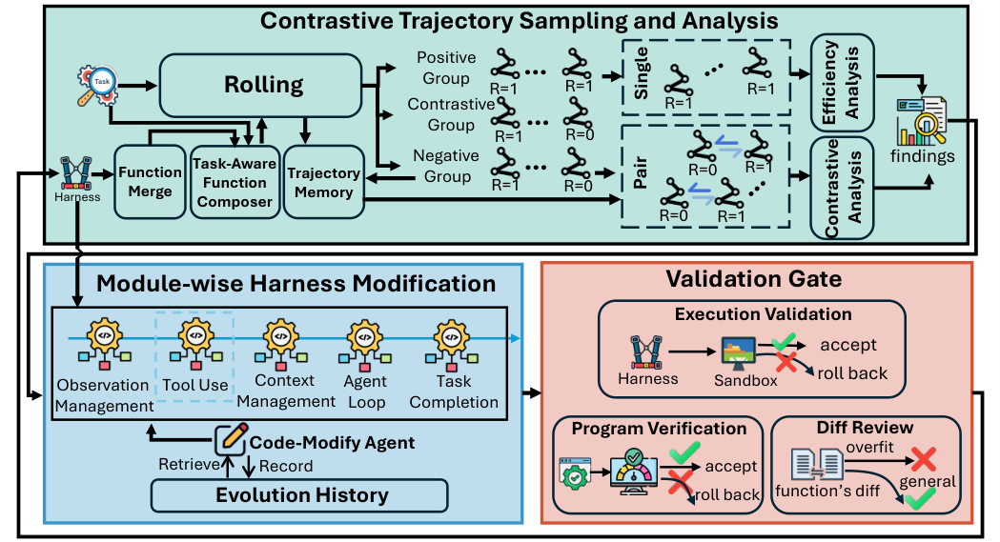

# ModularRSI: Modular and Generalizable Recursive Harness Self-Improvement

> Beihang University / University of Manchester / IQuest Research / M-A-P / Langboat 等 · 2026-09-14 · paper · **闭环** · [论文](https://arxiv.org/abs/2609.14857)
> 机制族：Harness 搜索与进化 · 来源核验 2026-09-17 · 复现状态 not-run

## Pipeline

对同一任务上成功与失败轨迹做对比分析，驱动五个 harness 模块（智能体循环、工具使用、观测管理、上下文管理、任务完成检测）各自在受限范围内独立进化；随后一轮跨模块集成解决冲突（重复、职责、协作）再冻结模块库。进化使用 2,000 条人工策划、与评测基准刻意不相交的可执行任务。

*图源：Figure 1 (S2.F1)*
## 结果（作者报告，非本地复现）

TerminalBench 2.0（DeepSeek-V4-Flash）：域内准确率 47.57→52.43、Pass@3 58.43→65.17；TB 上进化的 harness 迁移到 SWE-bench Verified，域内 73.40→76.45，SWE 上进化的 harness 在 TB 域外达 49.40。冻结 harness 跨模型迁移：GLM-5.2 59.55→61.80、MiniMax-2.5 41.57→44.94。与基线比较：61.79→67.42，优于 AHE 62.54 与 Meta-Harness 62.92。

## 证据边界

作者明确未做隔离对比轨迹分析贡献的专门消融，且成本使进化实验只用了 2,000 条任务的子集。

## 对 nanoRSI 的输入

对 nanoRSI：把 harness 分解为具名模块并限定各自编辑范围，在与基准不相交的可执行任务上用成功/失败对比对分别进化，合并库须经显式冲突消解轮再冻结。

## 来源

[arXiv abstract](https://arxiv.org/abs/2609.14857) · [arXiv HTML v1](https://arxiv.org/html/2609.14857v1)
