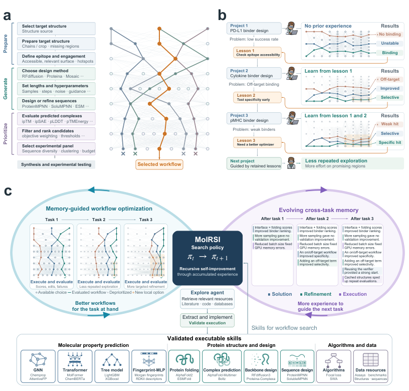

# MoLRSI: A Recursive Self-Improving AI agent for Molecular Discovery

> Northeastern University / Broad Institute / Harvard / MIT / Microsoft Research 等 · 2026-10-29 · paper · **闭环** · [论文](https://arxiv.org/abs/2610.39714)
> 机制族：技能文件优化与技能库（手写深记） · 来源核验 2026-11-02 · 复现状态 not-run（未核验到官方代码/权重/数据包）

## Pipeline

MoLRSI 把分子发现做成递归自改进循环，改进对象是**可执行的科研技能与搜索策略**。文献、代码、工具与模型方法被整理为可验证的 executable skills；一个经验引导的 Monte Carlo 树搜索组合并修订工作流（节点=工作流方案，经验=先验引导）。三**类持久记忆**按职责分离：solution memory 保存各工作流的表现、refinement memory 保存修改的后果、execution memory 保存执行期修复——跨任务经验由此改变后续搜索的先验。评估协议把"当前任务内有经验"、"跨任务 RSI 经验"与"zero-search transfer"三种条件分开比较，并在 25 个来源任务严格排除目标任务的前提下报告留出成绩。

*图源：Figure 1，arXiv HTML 2610.39714*

## 结果（作者报告，非本地复现）

- 六个抗菌任务（test AUPRC，25 个来源任务排除目标）：**跨任务经验在全部六项提高**；记忆池从 2 增至 25 个来源任务时平均迁移约 0.32 → 0.37，超过"无 RSI 搜索 20 次"的 0.361。
- 湿实验：107 个候选得 17 个 MSSA 命中（15.9%），对照专家工作流 241 个候选 8.7%；pMHC 设计 8 个实验命中，Claude Science 为 0。

## 证据边界

数字为作者在分子发现领域的报告，不能外推为通用 RSI；论文页标注 CC BY 4.0，但截至核验日**无官方代码、权重或可下载数据/实验包**。基准（抗菌、pMHC）与"来源任务排除"的划分由作者设定；湿实验对照的搜索预算匹配度未在本轮核验中确认。

## 对 nanoRSI 的输入

三条直接可执行：①**跨运行记忆与本轮适应分账**——把"来自记忆池的建议"与"本轮新搜索"的贡献分开记录（我们的经验库 lesson 正缺这个归因列）；②严格排除目标任务的来源经验 + 无搜索迁移/从零搜索两个对照列；③在匹配 token/episode 预算下报告留出迁移、记忆池规模、父代重测与失败修复——与我们 freeze 后终测、父代同场重测的纪律同构。

## 来源

[arXiv abs 2610.39714](https://arxiv.org/abs/2610.39714) · [arXiv HTML](https://arxiv.org/html/2610.39714)
