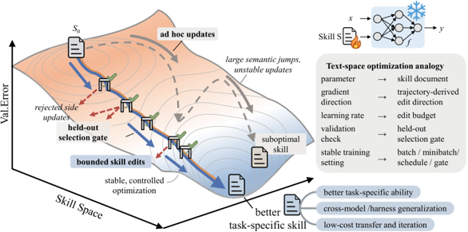

# SkillOpt: Agent skills as trainable parameters

> Microsoft Research · 2026-06-30 · report · **闭环** · [论文](https://www.microsoft.com/en-us/research/blog/skillopt-agent-skills-as-trainable-parameters/) · [仓库](https://github.com/microsoft/SkillOpt)
> 机制族：技能文件优化与技能库 · 来源核验 2026-10-16 · 复现状态 not-run

## Pipeline

把自然语言技能文件当作“活在冻结目标模型之外的 可训练参数”。由独立的优化器模型在文本空间跑前向-反向-更新环：前向 = 冻结目标执行任务批；反向 = 优化器按小批反思轨迹；更新 = 小幅增/删/改编辑，经合并、去重、排序，并由“文本学习率”（每步编辑预算）裁剪。验证闸门严格：仅当编辑在留出验证切分上严格高于当前技能才被采纳；被拒编辑进入缓冲区作为负反馈复用，逐 epoch 的慢/元更新沉淀更长程的教训。权重从不更新，推理不增加额外模型调用；交付物是 best_skill.md。

*图源：Figure 1, MSR blog 'SkillOpt: Agent skills as trainable parameters' (2026-06-30)*
## 结果（作者报告，非本地复现）

在报告的全部 52 个评测格中最佳或并列最佳（博文口径），覆盖六个基准（SearchQA、SpreadsheetBench、OfficeQA、DocVQA、LiveMathematicianBench、ALFWorld）、七个模型（GPT-5.5 到 Qwen3.5-4B）与三种执行模式（直连、Codex、Claude Code），对照包括人工技能、一次性 LLM 技能、Trace2Skill、TextGrad、GEPA 与 EvoSkill。带技能的 GPT-5.4-mini（64.3）胜过不带技能的 GPT-5.4（59.7）。编辑极小：终版技能中位约 920 token、仅 1–4 条被采纳的编辑；OfficeQA 的 +39.0 来自单条编辑。跨 harness 迁移：Codex 训出的技能放进 Claude Code 从 22.1 升到 81.8。

## 证据边界

博文级证据：“52 格”是博文对 6×7×3 空间的自报计数（全集的子集，未逐格公开）；GPT-5.5 六基准 58.8→82.3 等均值未给方差或种子数；方法适用于“存在自动评测或可靠验证器之处”。未核验到 arXiv 论文，数字以官方报告为准；52 格细节无法独立重算。

## 对 nanoRSI 的输入

正是 nanoRSI skills 模板缺的模式：文本学习率（每步有界编辑数）、严格“留出验证上严格更好才采纳”的闸门、复用为负反馈的被拒编辑缓冲、逐 epoch 汇总一遍——全部可在现有技能文件周围用标准库实现。终版技能中位约 920 token、仅 1–4 条采纳编辑，是“小技能即足”的参考预算。

## 来源

[MSR blog: SkillOpt](https://www.microsoft.com/en-us/research/blog/skillopt-agent-skills-as-trainable-parameters/) · [SkillOpt code](https://github.com/microsoft/SkillOpt) · [SkillOpt project page](https://aka.ms/skillopt)
