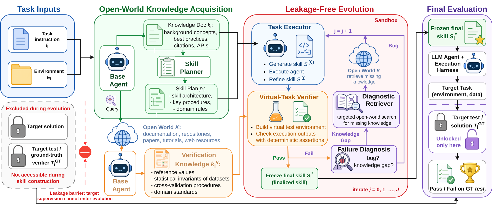

# OpenSkill: Open-World Self-Evolution for LLM Agents

> Lehigh University / University of Illinois Chicago / University of British Columbia / Vector Institute / Salesforce AI Research / Massachusetts General Hospital / Harvard Medical School · 2026-06-04 · paper · **闭环** · [论文](https://arxiv.org/abs/2606.06741) · [仓库](https://github.com/OpenLAIR/OpenSkill)
> 机制族：技能文件优化与技能库 · 来源核验 2026-09-17 · 复现状态 not-run

## Pipeline

技能与其验证信号都从零构建、无目标任务监督：开放世界知识获取从文档、仓库、论文与网络检索任务知识与验证锚点（查询经过滤去掉基准名防泄漏）；无泄漏技能进化按计划起草 1-4 个技能，对照锚定在可独立验证事实上的自制'虚拟测试'迭代精炼（至多 3 轮），gap-vs-bug 分类器触发定向检索；零样本评估把最终技能工件部署给任意智能体——隐藏真值测试只在此时使用。

*图源：Figure 2*
## 结果（作者报告，非本地复现）

SkillsBench：Opus 4.6 43.6% 对最强基线 Skill-Creator 34.7%（+8.9；人类 44.5%）；GPT 5.2 42.1% 对 CoT 33.3%（+8.8；人类 44.8%）——Opus 上距人类技能作者仅 1 分。SocialMaze/ScienceWorld 四列全胜；向四个较弱模型迁移 +5.5-14.8 分。验证器质量：精度 56.9%、召回 80.5%、覆盖 88.9% 真值测试意图。成本如实报告：端到端约 114 万 token/约 131 分钟（总估约 1800 美元）。

## 证据边界

网络来源可能噪声大或自相矛盾（需溯源）；虚拟测试可能过易（高估技能质量），若源自隐藏答案则重新引入监督泄漏；开放世界检索增加延迟与 token 成本。

## 对 nanoRSI 的输入

对 nanoRSI：无评估器时，先从可独立验证的事实构建验证锚点、再构建技能；并从检索查询中剥离基准名作为标准防泄漏卫生。

## 来源

[arXiv abstract](https://arxiv.org/abs/2606.06741) · [Paper v1 (affiliations, Figure 2, tables)](https://arxiv.org/html/2606.06741v1) · [Code repository (Apache-2.0)](https://github.com/OpenLAIR/OpenSkill)
