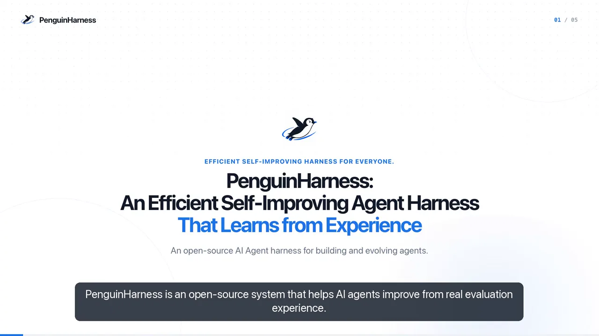

# PenguinHarness: Harness for RSI. Let AI Build AI

> Prism Shadow (PrismShadow AI Team, Yaowei Zheng) · 2026-07-19 · release · **闭环** · [论文](https://github.com/Prism-Shadow/penguin-harness) · [仓库](https://github.com/Prism-Shadow/penguin-harness)
> 机制族：Harness 搜索与进化 · 来源核验 2026-09-20 · 复现状态 not-run

## Pipeline

本地优先的多智能体 auto-dev 平台（桌面应用、CLI、npm、Docker；宣称支持 1000+ 模型并以 DeepSeek 级开源模型为默认）内置自进化引擎：agent 自评自优——跑基准、找失分点、发布 N+1 版，每轮前有快照、每个请求可在 Trace 视图检查；agent 还可编写并优化自己的技能。

*图源：Official site self-evolution poster (benchmark → find the lost points → ship vN+1)*
## 结果（作者报告，非本地复现）

核验时为自我报告的营销级声明：数据分析最佳准确率、成本为 Claude Code 的 1/70；图表标题称领先数据分析套件并在编码上打平 OpenAI Codex；一个完整 RAG 演示应用在 DeepSeek V4 Pro 上仅花 0.02 美元 token 生成。这些声明未附带基准方法学、套件或原始数字（基准套件公开发布仍在路线图）。

## 证据边界

头条数字为无公开方法学的自我营销声明；基准套件尚未公开；2.3k 星项目迭代极快（发版以天计）；无同行评审评测。

## 对 nanoRSI 的输入

在数字可核验之前就值得借鉴其可追溯纪律：每轮自进化前做快照、每个请求可检查，使自改代理的历史可回放——与 nanoRSI 证据账本所强制的性质相同。

## 来源

[GitHub repository](https://github.com/Prism-Shadow/penguin-harness) · [README (mechanism and claims)](https://raw.githubusercontent.com/Prism-Shadow/penguin-harness/main/README.md) · [Website](https://penguin.ooo/)
