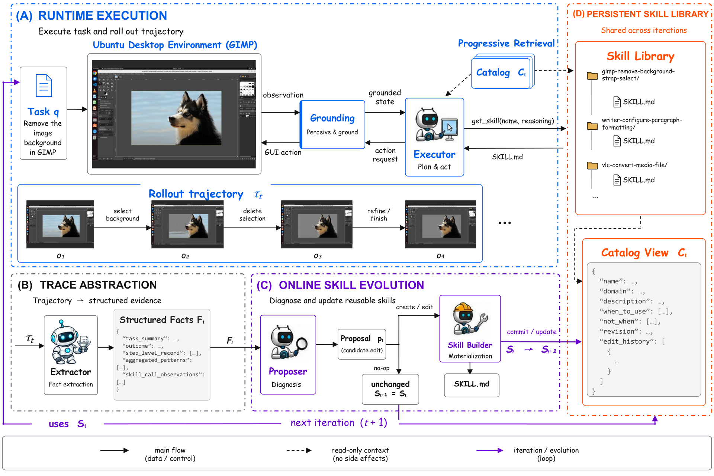

# From Interaction Traces to Persistent Skills: Online Evolution for Computer-Use Agents

> University of Electronic Science and Technology of China / Zhejiang University · 2026-09-04 · paper · **闭环** · [论文](https://arxiv.org/abs/2609.04869) · [仓库](https://github.com/LongtaoHu/Skill-Evo4GUI)
> 机制族：技能文件优化与技能库 · 来源核验 2026-09-15 · 复现状态 not-run

## Pipeline

每轮迭代在持久技能库的冻结快照上执行 GUI 任务；抽取器把轨迹转为结构化事实，提案者诊断并起草候选修改（新建/编辑/删除/显式 no-op），构建者把通过的材料化为带编辑历史的版本化 SKILL.md。反馈来自评测结果与轨迹证据；唯一被修改的对象是技能库，模型权重保持冻结。

*图源：Figure 1*
## 结果（作者报告，非本地复现）

在与配置完全对齐的空技能库对照（同一动作生成与 GUI 定位栈、同一任务集与迭代轮数）下，系统在 OSWorld 四个应用域的预热后（t>=5）平均评测分全部更高，平均差 +5.7 至 +18.6 个百分点。GIMP 域的来源分析记录了跨任务复用与“修订抖动”：反复被接受的编辑仍可能无法恢复其来源任务——该负结果被保留。

## 证据边界

证据限于 OSWorld 四个域和作者自建评测器；收益依赖评测信号质量，绝对分数距离饱和仍远。尚无第三方复现。

## 对 nanoRSI 的输入

把“冻结快照 + 版本化 SKILL.md + 显式 no-op”纪律移植进 nanoRSI 技能环：候选修改进入版本库，每个 episode 在冻结快照上运行，来源日志揭示哪些技能真的被检索、是否仍能解出来源任务。

## 来源

[arXiv abstract](https://arxiv.org/abs/2609.04869) · [Paper v1 (affiliations, Figures 1-2, Tables 1-2)](https://arxiv.org/html/2609.04869v1) · [Author code repository](https://github.com/LongtaoHu/Skill-Evo4GUI)
