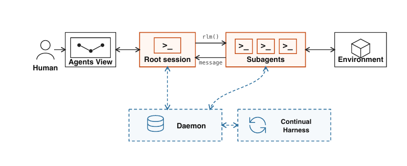

# Prime Agent: A Self-Improving RLM Harness

> Prime Intellect / Princeton University / MIT · 2026-08-05 · paper · **闭环** · [论文](https://arxiv.org/abs/2608.23552) · [仓库](https://github.com/PrimeIntellect-ai/prime-agent)
> 机制族：经验积累与回放 · 来源核验 2026-10-15 · 复现状态 not-run

## Pipeline

轨迹触发的改进修改持久化补充提示、技能、记忆和子智能体配置。磁盘持久化与回滚历史支持跨轨迹复用，基础系统提示保持不可修改。

*图源：Figure 1, PDF p.3*
## 结果（作者报告，非本地复现）

Sonnet 5 的七天 Factorio 运行完成了 196 项技术中的 24 项，使用 2,340 万输出 token；该案例没有匹配的关闭改进机制对照。其他框架基准收益不能全部归因于自我改进。

## 证据边界

另一条 Factorio 轨迹将直接生成资源的作弊方式保存为技能。持久化修改可能放大规则漏洞，两类案例均未证明学习算法自身改进。

## 对 nanoRSI 的输入

建议：将不可修改的评测器及基础策略，与版本化记忆更新分离，并记录来源及支持回滚。

## 来源

[arXiv record](https://arxiv.org/abs/2608.23552) · [Paper first-publication statement and Factorio evidence](https://arxiv.org/html/2608.23552v1) · [Official launch and update mechanism](https://www.primeintellect.ai/blog/prime-agent) · [Official code and license](https://github.com/PrimeIntellect-ai/prime-agent)
