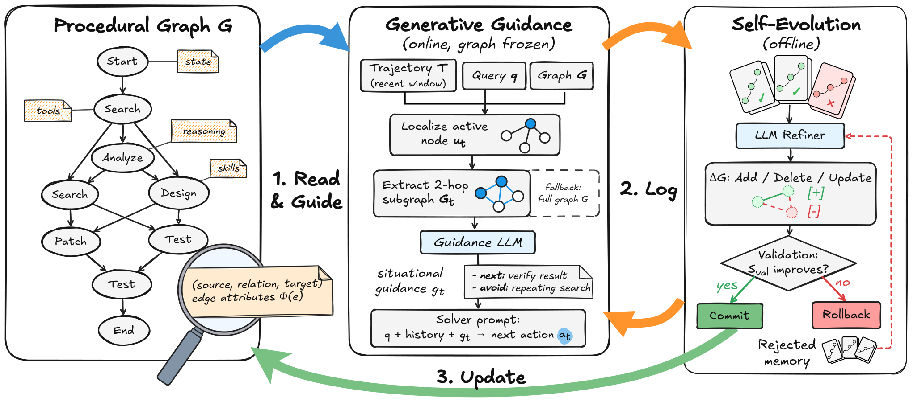

# Procedural Graphs: Self-Evolving Execution Structures for LLM Agents

> Google / Georgia Institute of Technology / Peking University · 2026-09-08 · paper · **闭环** · [论文](https://arxiv.org/abs/2609.09153)
> 机制族：结构化知识库与图 · 来源核验 2026-09-15 · 复现状态 not-run

## Pipeline

程序性知识以（程序，关系，程序）三元组及边属性存储，构成类比知识图谱的“程序图”。运行时智能体定位活跃节点、抽取 2 跳子图，引导模型将其转为只引导不代做的步骤级建议。离线自进化中，LLM 精炼器对比失败与成功轨迹并提出图编辑（增/删/改）；编辑只有在留出验证性能保持或提升时才提交，被拒编辑留在“拒绝记忆”中以防重复提议。

*图源：Figure 2*
## 结果（作者报告，非本地复现）

在 EnterpriseArena（跨连续宏观危机的流动性管理，Gemini 3.5 Flash）上，自进化第 1 轮新增“核对现金/预测资金跑道”节点，把验证存活率从 0.0% 提到 45.0%；第 2 轮新增笔记复用，存活率提至 80.0%，且相对无引导基线每月工具调用从 17.23 降到 3.08；第 3-6 轮无任何提交（一个候选未过结构校验）——空转轮次被如实报告。在 HotpotQA、MultiChallenge 及 ALFWorld 类任务上，学到的图持平或超过手工引导与记忆基线。

## 证据边界

自进化案例为单模型（Gemini 3.5 Flash）；未发布代码；“持平或超过手工图”依赖作者自建基线；引导质量受引导模型能力上限约束。

## 对 nanoRSI 的输入

给 nanoRSI 自身改进环维护一张小程序图（提案、评测、提交），让精炼器阅读失败与成功 episode 的对比，并加显式“拒绝编辑”记忆避免重复提议；每次编辑都以冻结验证分为闸门。

## 来源

[arXiv abstract](https://arxiv.org/abs/2609.09153) · [Paper v1 (affiliations, Figure 2, Section 5.4)](https://arxiv.org/html/2609.09153v1)
