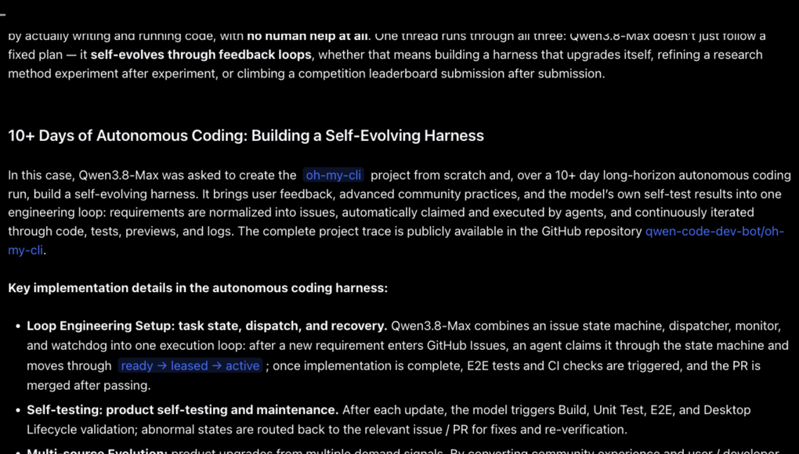

# Qwen3.8-Max: A New Bar for Coding and Cowork (self-evolving harness demonstrations)

> Alibaba (Qwen team) · 2026-08-03 · report · **闭环** · [论文](https://qwen.ai/blog?id=qwen3.8) · [仓库](https://github.com/qwen-code-dev-bot/oh-my-cli)
> 机制族：Harness 搜索与进化 · 来源核验 2026-09-14 · 复现状态 not-run

## Pipeline

三个长程演示，模型通过反馈回路修改自身工作基础设施：(1) 从空文件夹起用 10+ 天自主运行构建 oh-my-cli 项目，配合 issue 状态机、调度器、监控与看门狗——"需求归一化为 issue，由 agent 自动认领执行，经代码、测试、预览与日志持续迭代"；(2) 从零复现论文《Unified Data Selection for LLM Reasoning》（约 125 小时、约 7,600 行代码、33 轮 GPU 训练），再以"假设→写码→上 GPU→分析"的自改进环在四轮中自提 18 个改进想法；(3) 竞赛榜单迭代。

*图源：Section '10+ Days of Autonomous Coding: Building a Self-Evolving Harness'*
## 结果（作者报告，非本地复现）

自报结果：oh-my-cli 自主运行约 16 天累计 265 次提交、127 个 PR、151 个 issue（截至 2026 年 7 月 30 日）；研究复现环节先复现论文六项主要发现（其选择法在 AIME24 上超随机 +7.7%），再演化出在 AIME24 上超过原方法 +2.7 分的新方法。

## 证据边界

属演示而非受控实验：harness 运行没有公开基线 harness、固定种子对照或成本控制；AIME24 +2.7 分为单模型自报结果，无方差与独立核验。审计时点的开放权重状态：页面承诺公开，但本次运行未核验到已发布。

## 对 nanoRSI 的输入

建议：搭建最小 issue 环路 harness，让 nanoRSI 的改进器认领、实现并验证自己仓库的 issue，在同一 issue 流上与固定计划对照比较有效 diff 产出率与回归率。

## 来源

[Official Qwen blog post (opened via browser)](https://qwen.ai/blog?id=qwen3.8) · [Demonstration repository with full trace (Apache-2.0)](https://github.com/qwen-code-dev-bot/oh-my-cli)
