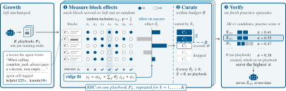

# Reliable Memory from Unstable Growth: Curating Self-Written Agent Playbooks with Randomized Experiments

> Nanyang Technological University / VinUniversity · 2026-10-13 · paper · **闭环** · [论文](https://arxiv.org/abs/2610.18427)
> 机制族：经验积累与回放 · 来源核验 2026-10-15 · 复现状态 not-run

## Pipeline

把自写手册当实验对象而非文本：经验条目嵌入后 Ward 聚类成 m=8 个主题块；练习任务上每块以 p=1/2 独立入选（二水平因子设计），对成功指示符做岭回归估计每块效应——恰等于其在随机共服务子集上的 Banzhaf 值。只有效应为正的块才被服务（按效应从高到低、40% token 预算内）；若全无正效应则不服务任何手册。RBC 长出 K=3 本手册、各自策展，再在新鲜练习局上验证 2K+1 个候选（策展集、完整手册、空集）并服务胜者。生长过程不变；策展零 LLM 调用。

*图源：Figure 1 (f_main.svg): three curation designs contrasted - (a) agent self-judgment, (b) context valuation of random subsets, (c) RBC's randomized block inclusion on practice tasks with keep-only-helpful selection*
## 结果（作者报告，非本地复现）

2 个记忆系统（ACE、Dynamic Cheatsheet）×3 模型（Qwen3.8-27B、Qwen3.5-9B、Gemma-4-31B）×3 基准（AppWorld、WebShop、ALFWorld）：RBC 平均 66.9，对完整手册 55.5、无手册 54.1、agent 自选 53.8。最坏案例：Qwen 27B AppWorld（成败型反馈）上完整手册比无手册低 69.6 分（19.2 对 78.4）。ACE 上 RBC 至多比无手册低 0.8，而每个基线都至少在某处跌 5.4 以上。

## 证据边界

块粒度固定为 m=8 个 Ward 簇；策展期间练习任务使服务成本翻倍；评测覆盖三个交互式基准与三个开源权重模型；小练习样本下块效应估计有噪（靠岭回归收缩）。

## 对 nanoRSI 的输入

RBC 是 ADOPTION 第 48 项'每技能效用账本'的可插拔因果升级：不记检索相关性效用，而是测量每技能块在冻结面板局上的随机开/关效应（Banzhaf/岭回归估计只需 nanoRSI 已记录的入选指示与结果），按符号而非感觉退役或保留技能块。69.6 分的最坏案例是对整份服务自写技能文件的常鸣警示。

## 来源

[arXiv abstract](https://arxiv.org/abs/2610.18427) · [arXiv HTML v1](https://arxiv.org/html/2610.18427v1)
