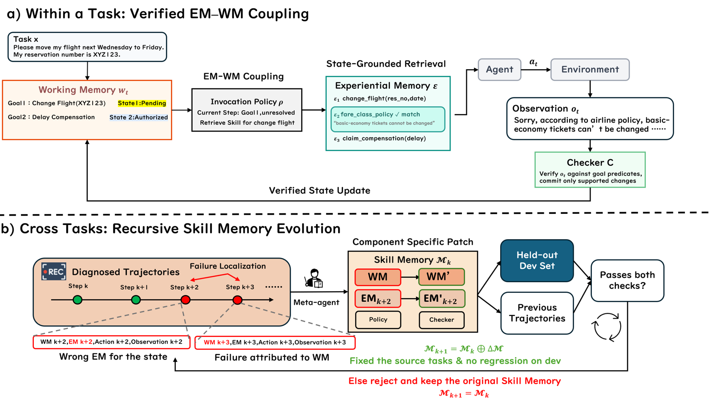

# Recursive Experiential-Working Memory Evolution for Long-Horizon Agent Harnesses

> National University of Singapore / Stanford University / University of Oxford / Princeton University · 2026-08-25 · paper · **闭环** · [论文](https://arxiv.org/abs/2608.24876) · [仓库](https://github.com/Gen-Verse/Recuris)
> 机制族：结构化知识库与图 · 来源核验 2026-09-17 · 复现状态 not-run

## Pipeline

工作记忆（经验证的任务状态：待办/完成/阻塞目标，仅由观察支持的检查器谓词提交）与经验记忆（技能）耦合，由匹配当前状态的调用策略检索——结构化轨迹使失败定位率达 64.8%，对仅结果反馈的 13.0%。跨任务由固定元智能体把失败定位到四组件之一（技能、工作记忆规格、调用策略、检查器），只修补被牵连的组件，且固定验证闸门只在'修复来源任务且不伤留出开发集'时放行。基座 LLM 与外层流程冻结。

*图源：Figure 3*
## 结果（作者报告，非本地复现）

37 个完成的模型-基准对中 35 个提升。Tau2-Retail：GPT-5.6 Sol 58.3 -> 76.1、Claude Opus 5 72.4 -> 87.9、Doubao-2.0-Pro 58.1 -> 81.4（+23.3）、Granite-4.1-3B 9.7 -> 23.0。SkillFlow（Qwen3.6-27B）42.2 -> 58.7。留出进化：对初始记忆 +9.01~+17.44，第二轮再复利 +6.98——罕见的多轮增益。保留诚实警示：Terminal-Bench 2.1 适应效应 +2.3、p=0.774（'方向而非效应'），13 次运行未放行任何补丁。

## 证据边界

无专门局限性章节，但论文保留了自身的噪声披露（tau2-Airline 置信区间含零；时程分析是分层再分析；记忆在单一中型部署模型上进化；留出任务缺可修复失败类型时迁移失败）。

## 对 nanoRSI 的输入

对 nanoRSI：四组件定位（技能/记忆规格/检索策略/检查器）加'修复且不回退'闸门，是把失败归因到唯一可编辑面再提补丁的具体蓝图。

## 来源

[arXiv abstract](https://arxiv.org/abs/2608.24876) · [Paper v1 (affiliations, Figure 3, tables)](https://arxiv.org/html/2608.24876v1) · [Code repository (Apache-2.0)](https://github.com/Gen-Verse/Recuris)
