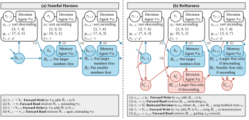

# Recurrent Harness for Agentic Continual Learning

> Meta / Massachusetts Institute of Technology / Yale University · 2026-10-08 · paper · **闭环** · [论文](https://arxiv.org/abs/2610.12668)
> 机制族：经验积累与回放 · 来源核验 2026-10-14 · 复现状态 not-run

## Pipeline

harness 状态是从历史轨迹写出的文本反思集合。常规有状态 harness 只向前传播（写反思、检索反思），一条过度泛化的反思会持续误导后续实例。ReHarness 增加反向修订 agent：每条轨迹结束后只用当次结果作反馈重写被检索的反思，任何新内容必须锚定该反思的源轨迹——防止泄漏；修订后的反思替换原件并作为写下一条反思的示范，在严格在线流式协议下闭合「向前读 / 向后改 / 向前写」的循环。

*图源：Figure 1 (pipeline.svg): from stateful agent harnesses to ReHarness, panels (a) forward-only propagation vs (b) backward revision of retrieved reflections*
## 结果（作者报告，非本地复现）

在 CL-Bench、MemoryBench、MemoryArena × Claude Opus 4.8、GPT-5.5、Gemini 3.7 Flash 上平均归一化增益 0.240，9 个组合中 8 个最佳或并列最佳，对照 Top-K Raw 0.168、Full Raw 0.164、GEPA-Online 0.092、Mem0 0.131、DoT 0.071、ACE 0.043、RBank 0.034；对所有基线的增益均统计显著（Wilcoxon 加 Bonferroni，如对 Top-K Raw p_adj=0.039）。CL-Bench + Claude 的 token 成本约 41.57M（254 美元），对 Full Raw 约 142.12M（314 美元）；CL-Bench 分布漂移下稳定性与可塑性最高。

## 证据边界

在可利用的扑克任务上表现不佳——那里奖励对修订而言是噪声随机信号；仍需存原始轨迹供后续修订，带来存储开销。

## 对 nanoRSI 的输入

锚定源轨迹的反向修订可映射到 nanoRSI 技能轨：被拒候选应修订它实际使用的那条技能，修订内容限定在失败证据内——该锚定约束与反事实面板的反捷径纪律同源；修订幅度随时间收敛（其图 4a）是证据账本可审计的收敛信号。

## 来源

[arXiv abstract](https://arxiv.org/abs/2610.12668) · [arXiv HTML v1](https://arxiv.org/html/2610.12668v1)
