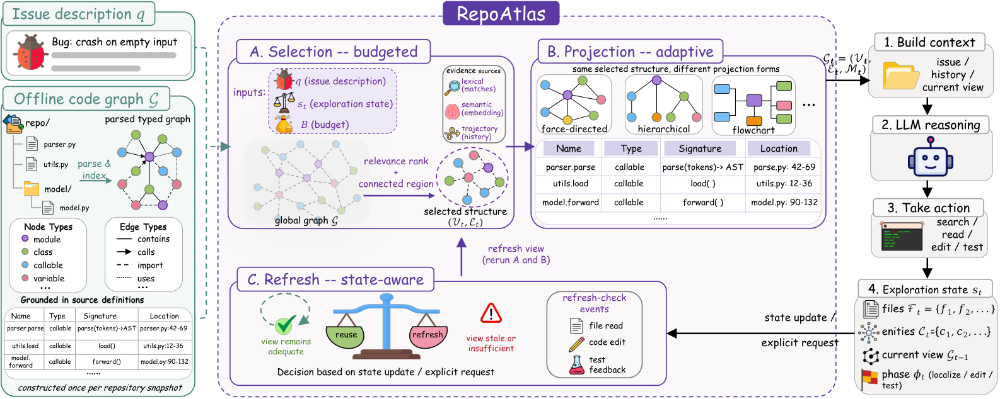

# RepoAtlas: Guiding Coding Agents via Evolving Multimodal Repository Views

> Beihang University / Independent Researcher · 2026-09-15 · paper · **支撑·无闭环** · [论文](https://arxiv.org/abs/2609.16936)
> 机制族：上下文组织策略 · 来源核验 2026-09-18 · 复现状态 not-run

## Pipeline

免训练的选择-投影-刷新循环在代码图上维护演化的仓库视图：以固定节点预算按议题与探索状态选区、投影为互补的视觉与文本表示、状态变化致视图过期时刷新。

*图源：Figure 2 (fig_overview.png)*
## 结果（作者报告，非本地复现）

SWE-bench Verified：相对最强多模态图基线解决率 +2.4 分，输入 token 少 5.8%、模型调用少 7.8%，三个模型族一致（Qwen3.6-35B-A3B、MiMo-V2.5、Kimi-K2.5）；匹配 15 节点预算下，选择阶段把 LocBench FA@3 从 0.256 提到 0.336。

## 证据边界

增益相对图接口基线而非最强整体智能体；演化对象是仓库视图而非智能体本身。

## 对 nanoRSI 的输入

给 nanoRSI 技能配每技能'视图'（漂移即刷新的文件白名单）替代全树上下文；刷新触发器即为上下文版的契约守卫。

## 来源

[arXiv abstract](https://arxiv.org/abs/2609.16936) · [Paper HTML (affiliations, Figure 2, selection ablation)](https://arxiv.org/html/2609.16936v1)
