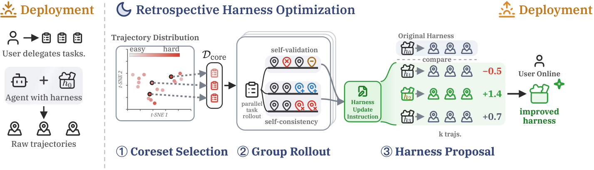

# Evolving Agents in the Dark: Retrospective Harness Optimization via Self-Preference

> Microsoft Research Asia / City University of Hong Kong · 2026-06-04 · paper · **闭环** · [论文](https://arxiv.org/abs/2606.05922) · [仓库](https://github.com/wbopan/retro-harness)
> 机制族：Harness 搜索与进化 · 来源核验 2026-09-19 · 复现状态 not-run

## Pipeline

无需标注或验证反馈的 harness 优化：DPP 选出的历史任务核心集分组重解，从轨迹蒸馏诊断线索，改写全栈 harness（指令、技能、可执行工具），再由 agent 自身成对排序候选（自偏好）选 N=3 中最优。

*图源：Figure 2 (fig2-pipeline.png)*
## 结果（作者报告，非本地复现）

Codex（GPT-5.5 high）单轮优化：SWE-Bench Pro 0.59→0.78、Terminal-Bench 2 0.71→0.76、GAIA-2 0.29→0.37；三项全面超过免反馈基线（Dynamic Cheatsheet/ReasoningBank/Sleep-time Compute）；验证反馈型 Meta-Harness 需 10 轮（约 3.1× 算力+标注）才到 0.80。

## 证据边界

自偏好可能排错（消融：选中候选能避开最差但未必是经验最优）；分组 rollout 假设环境可干净重置；作者警示错误自偏好可能放大不安全行为。

## 对 nanoRSI 的输入

nanoRSI 运行档案已存候选树；RHO 展示了免标注复用——在每个候选下重解难度多样的核心集再自排序。这是 ADOPTION 22 的免 oracle 扩展。

## 来源

[arXiv abstract](https://arxiv.org/abs/2606.05922) · [Paper HTML (affiliations, results, Figure 2)](https://arxiv.org/html/2606.05922v1) · [Code repository](https://github.com/wbopan/retro-harness)
