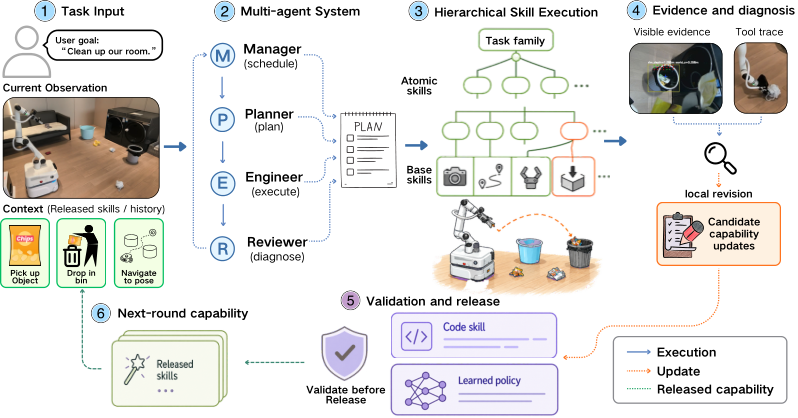

# RoboRSI: Stable, efficient, and reusable robot self-evolution in complex real-world environments

> Noematrix Lab · 2026-10-08 · paper · **闭环** · [论文](https://arxiv.org/abs/2610.12424) · [仓库](https://github.com/nssmd/RoboRSI)
> 机制族：技能文件优化与技能库 · 来源核验 2026-10-12 · 复现状态 not-run

## Pipeline

自顶向下技能精炼（TSR）把任务分解为复合、原子与基础技能，各带职责范围与显式输入输出契约，使执行失败可归因到负责分支，修订也只落在该分支。Manager 组织技能层级，Planner 组合执行计划，Engineer 执行，Reviewer 在发布前验证；人类通过目标与纠正进行导向；稳定序列固化为可复用复合技能。

*图源：Figure 2 (2027_ICLR_Framework2.0.png): Manager organizes the skill hierarchy, Planner composes the plan, Engineer executes, Reviewer validates before release*
## 结果（作者报告，非本地复现）

在实体移动操作机上，多物体家庭清理经 104 轮自演化长成；约一天的迭代对照项目页所述 2024 年参考（两名工程师、约一个月、2000-3000 行任务代码）。仿真中在 LIBERO、LIBERO-PRO、LIBERO-Plus 与 RoboTwin 上取得最高成功率，较最强基线高 2.7-11.0 个百分点；LIBERO 累计 95/120（初始 32/120），RoboTwin 36/50（初始 9/50）。在 840 个 LIBERO-Plus 扰动实例上，固定系统过 261（31.1%），自适应 pass@2 过 398（47.4%）。600 局的固化消融把通过率从 21.5% 提到 29.0%（+7.5 点），中位 token 下降 29.4%。

## 证据边界

实体结果来自单一移动操作平台上的两场景清理任务集；人类通过目标与纠正参与导向，自主性有界；基线差距（2.7-11.0 点）为作者在自有评测下报告；'一天对一个月'的对照引用团队自身 2024 年实践而非受控研究；一个图文件名提示 ICLR 2027 投稿，但未声称也未核验录用。

## 对 nanoRSI 的输入

对 nanoRSI 可移植的纪律是契约约束的修订：给每条技能显式输入输出契约使失败归因到分支，把编辑限制在该分支内，并要求 Reviewer 式验证后技能才能回到库中——再测量同面板上约束编辑是否以更少回归胜过整文件重写，与既有反事实面板互相印证。

## 来源

[arXiv abstract](https://arxiv.org/abs/2610.12424) · [arXiv HTML v1](https://arxiv.org/html/2610.12424v1) · [Apache-2.0 code release](https://github.com/nssmd/RoboRSI) · [Apache-2.0 license](https://github.com/nssmd/RoboRSI/blob/main/LICENSE) · [Noematrix Lab project page](https://lab.noematrix.ai/blog/2-roborsi/)
