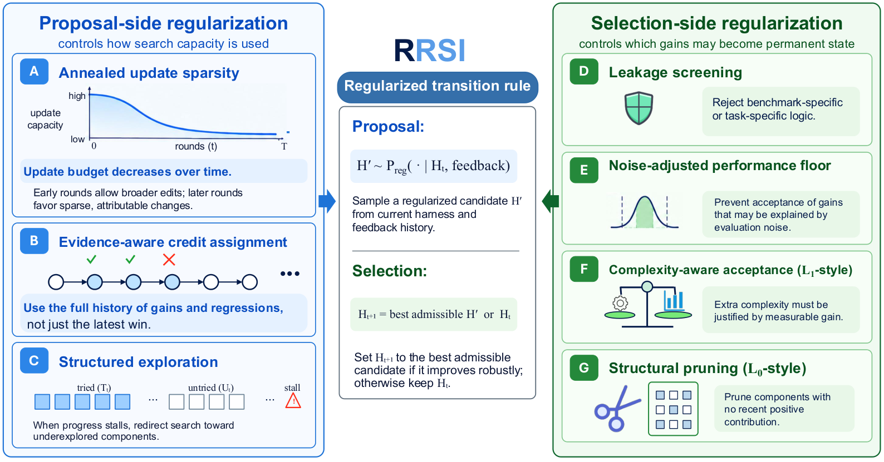

# RRSI: Regularized Recursive Self-Improvement of Agent Harnesses

> Google Cloud AI Research / Stanford University / Washington University in St. Louis / UNC-Chapel Hill · 2026-09-21 · paper · **闭环** · [论文](https://arxiv.org/html/2609.24972v1) · [仓库](https://github.com/google-research/rrsi)
> 机制族：Harness 搜索与进化 · 来源核验 2026-09-29 · 复现状态 not-run

## Pipeline

在冻结模型上运行有界的提案→反馈→选择 harness 闭环。提案侧逐轮降低一次可捆绑的编辑数，使用完整编辑历史分配信用，并在停滞时把搜索转向尚未尝试的组件；选择侧筛查基准特化逻辑，以重复基线评测校准噪声门槛，要求新增推理成本由可测增益支付，并裁剪近期没有正贡献的组件。被接受的 harness 提交成为下一代 incumbent；模型权重保持冻结。

*图源：Figure 2 (pipeline.png): proposal-side and selection-side regularization*
## 结果（作者报告，非本地复现）

在冻结 Claude Opus 4.8、匹配进化预算的条件下，RRSI 报告 Terminal-Bench 2.1 从 74.2→80.2（+6.0），SWE-bench Verified 从 82.0→83.8（+1.8）；留出/分布外评测中 JobBench 36.0→40.7、GDPval 48.8→52.3、APEX-Agents 34.2→37.9。论文报告分布外最高 +4.7 分，并比未正则化进化少 30% policy token；用未参与搜索的 Gemini 3.1 Flash Lite 评估进化后的 coding harness 时为 11.2→14.6（+3.4）。这些是作者结果，不是 nanoRSI 复现结果。

## 证据边界

主干模型、提案器、分析器和泄漏评论器依赖托管模型；基准及若干运行环境为外部且成本较高。方法仍依赖有限进化集、固定正则化超参数和带噪自动反馈。论文明确不研究模型权重更新；公开仓库没有发布权重，也没有随仓库提供完整基准数据快照。

## 对 nanoRSI 的输入

在 nanoRSI 现有 harness/skill 候选闸门上做小型离线消融：把当前严格改进选择与一个正则化臂比较，后者（1）由重复冻结评测估计噪声带，（2）跨轮记录组件级编辑信用，（3）用递减预算限制一次捆绑编辑数，（4）没有补偿性增益时拒绝新增测得成本。冻结当前臂、种子、被拒候选和留出 fixture 面板；在考虑改变默认行为前报告迁移、成本和拒绝原因。

## 来源

[arXiv paper and HTML](https://arxiv.org/html/2609.24972v1) · [Google Research repository](https://github.com/google-research/rrsi) · [Repository license](https://raw.githubusercontent.com/google-research/rrsi/main/LICENSE) · [Project page](https://regularized-rsi.com/)
