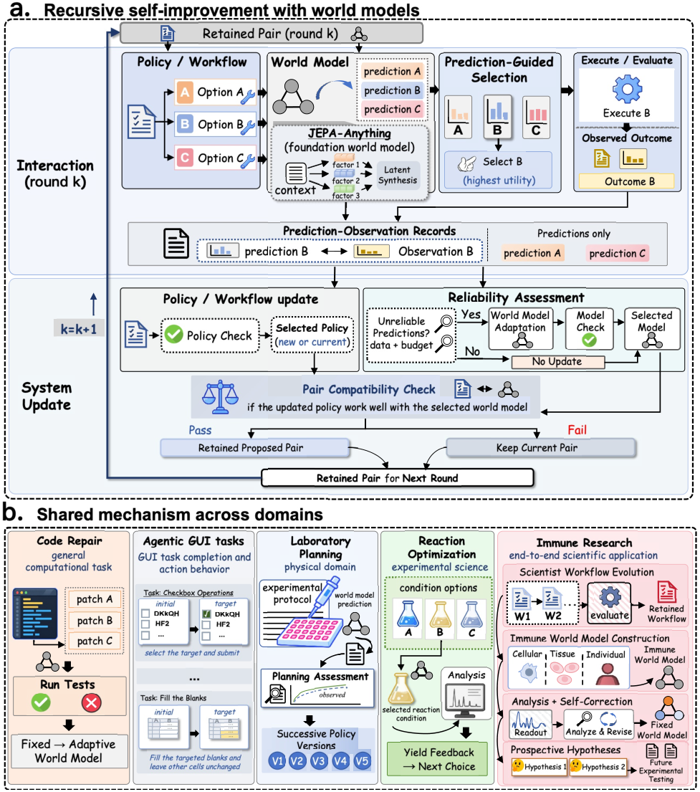

# RSI-Anything: Unlocking Recursive Self-Improvement with World Models

> PhAI Labs / The Chinese University of Hong Kong / University of Macau / Shanghai Jiao Tong University / Fudan University 等 · 2026-10-09 · paper · **闭环** · [论文](https://arxiv.org/abs/2610.13912) · [仓库](https://github.com/Gen-Verse/RSI-Anything)
> 机制族：自改写元智能体与谱系 · 来源核验 2026-10-14 · 复现状态 not-run

## Pipeline

构建在 JEPA-Anything 预测基座上，世界模型预测同时引导动作选择与学习数据选择，替代昂贵的外部反馈。观测到的反馈更新策略/工作流；当策略演化使世界模型可靠性下降时有条件地再适配，组件与兼容性检查决定更新后的策略-模型对是否保留。想象轨迹须经门控指标（候选合法、效用过阈、不确定度低于上限、证据标签属允许来源）才进入训练集，证据分层为 E0 规则检查 / E1 模型预测 / E2 仿真器 / E3 外部测量。

*图源：Figure 2 (figure1_v12_2026-10-09.png): RSI-Anything couples prediction-guided action with retained system updates, with domain instantiations in panel b*
## 结果（作者报告，非本地复现）

代码修复（200 道 CodeContests、固定 coder）：隐藏测试成功率 26.3%（静态验证器）/ 26.0%（随机选择）→ 29.2%（固定世界模型）→ 31.2%（世界模型适配后）；排序准确率 66.5%→72.8%，Brier 0.488→0.358。GUI：click-checkboxes 51%→99%，平均动作数降 39.4%（5.30→3.21），重复点击 237→0；OSWorld 相对 RLAnything +5.5%、对初始 agent +18.4%。实验室规划：LabHorizon F200 Level-2 五个 4B 策略版本从 21.80% 提到 46.01%，最终版本超过 Actor-Simulator-Selector 参照（46.01 对 45.32），并优于 Grok 4.3、Gemini 3.1 Pro、GPT-5.5、Kimi K2.6。反应优化：40 次 LC-MS 实验预算下平均最佳收率 96.15%，对贝叶斯优化 82.16%。另有端到端免疫科学应用把工作流演化与治疗假设生成耦合。

## 证据边界

单任务内策略与世界模型持续互改进的联合多轮评估仍待做；实验室结果只评协议对齐的规划、不含物理执行；化学仅覆盖报告预算下两组 Suzuki-Miyaura 筛选；免疫科学治疗假设待实验检验。

## 对 nanoRSI 的输入

对自生成训练数据的分层证据准入闸（E0-E3 标签加合法性、效用与不确定度检查）是 nanoRSI 反事实面板纪律的具体 schema；世界模型作为廉价预验证器、可靠性下降时再适配，可直接用作冻结选择器研究（ADOPTION 38-39 项）的低成本预排序臂。

## 来源

[arXiv abstract](https://arxiv.org/abs/2610.13912) · [arXiv HTML v1](https://arxiv.org/html/2610.13912v1) · [GitHub repository (Apache-2.0)](https://github.com/Gen-Verse/RSI-Anything)
