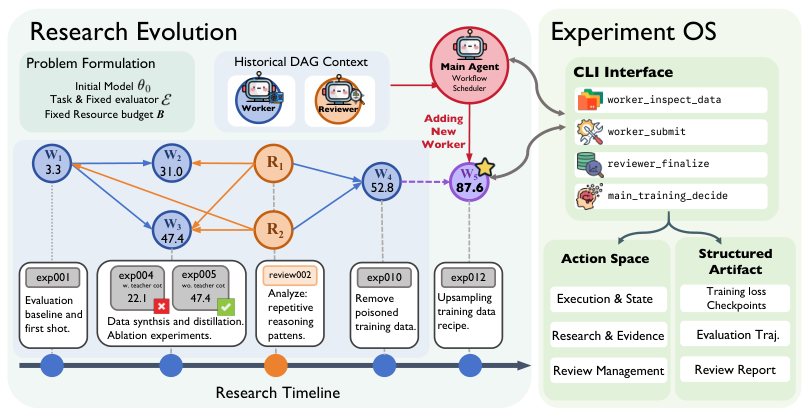

# RSI-Master: Structuring Experiments to Guide Autonomous Model Improvement

> Shanghai Jiao Tong University / University of Science and Technology of China / Shanghai AI Laboratory / Zhejiang University / University of California, Berkeley · 2026-09-28 · paper · **闭环** · [论文](https://arxiv.org/abs/2609.35561)
> 机制族：Harness 搜索与进化 · 来源核验 2026-10-08 · 复现状态 not-run

## Pipeline

RSI-Master 改变的是围绕冻结或另行训练模型的研究 harness：Experiment OS 将低层操作限制为可检查的 CLI 动作与结构化产物，reviewer-guided research DAG 让 worker 探索不同后训练方向，并由 reviewer 在增加 worker 或提升配方前比较证据。改变对象是实验/研究流程及其持久证据，不是通用的自主模型权重闭环。

*图源：Figure 2: RSI-Master methodology, Research Evolution and Experiment OS*
## 结果（作者报告，非本地复现）

在 Qwen3-4B-Base 的 PostTrainBench 上，论文报告平均分 54.49，对比最强 agent 基线 46.53，hacking rate 为 0.0%。35B 规模上，论文报告 LiveCodeBench-v6 为 41.21，对比人工开发 Instruct 模型 37.36，并在 SciCode 上有提升、在 HorizonMath 上取得非零结果。这些是论文在其模型、基准与计算条件下的作者结果，不是 nanoRSI 复现。

## 证据边界

本次核验可从摘要与 HTML 读取方法和主要指标，但未找到可独立核验的官方代码仓库、发布权重或可再分发的基准数据包。报告的 hacking rate 依赖作者的动作限制与评测器；论文不能证明通用 RSI 或向 nanoRSI 迁移。完整复现需要指定模型、后训练数据、基准环境和大量计算。

## 对 nanoRSI 的输入

只复用可移植的控制模式：在 nanoRSI 现有评测器外增加可选、离线的 research-DAG/evidence-ledger 对照。在匹配调用、token、种子和留出任务下比较单一方向、固定多方向调度与 reviewer 闸门扩展方向；记录每个 worker 提案、reviewer 决策、动作限制和被拒提升。不把论文基准增益写成本地结果，也不引入未获许可的代码。

## 来源

[arXiv abstract](https://arxiv.org/abs/2609.35561) · [arXiv HTML v2 and Figure 2](https://arxiv.org/html/2609.35561v2)
