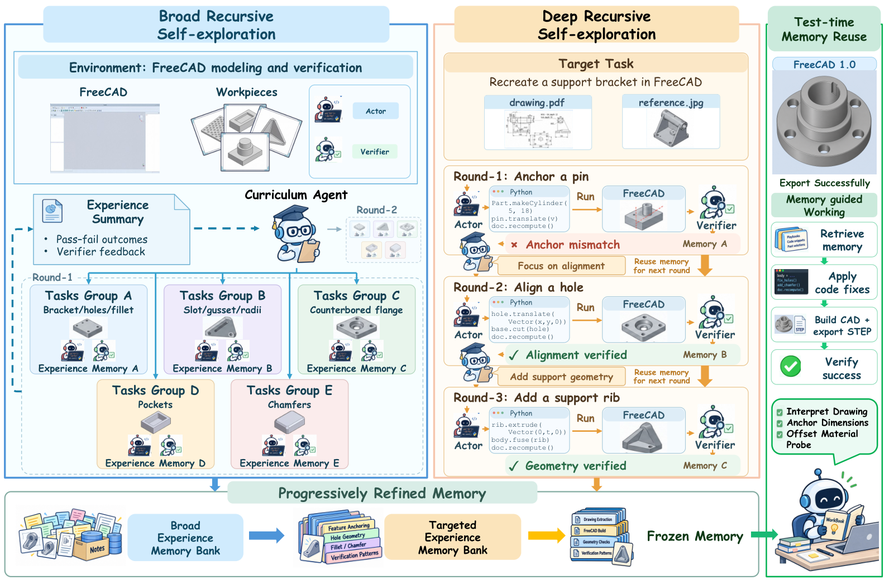

# RSIAgent: Autonomous Exploration for Recursive Self-improvement in New Environments

> Aether AI / University of California San Diego / University of Illinois Chicago · 2026-09-14 · paper · **闭环** · [论文](https://arxiv.org/abs/2609.15364) · [仓库](https://github.com/AetherLabsAI/RSIAgent)
> 机制族：探索式记忆构建 · 来源核验 2026-09-29 · 复现状态 not-run

## Pipeline

面向陌生环境的免训练多智能体自改进：课程、执行、验证三类智能体在无金标条件下探索。广度递归自探索（BRS）并行跑课程组织的任务组，绘制环境结构并存下按组分组的经验记忆——可复用的（动作、条件、后果）因果模式；深度递归自探索（DRS）再在目标任务上迭代，验证器裁决每次尝试，成功记忆回流到后续轮次。逐步精炼的记忆最终冻结供下游复用；全程不改模型参数。

*图源：Figure 2*
## 结果（作者报告，非本地复现）

以 GLM-5.3 为执行、Kimi-K3 为验证/课程：OSWorld 2.0 partial 78.98，高于 GPT-6 Astra 报告的 72.60（+6.38），binary 42.68；Agents' Last Exam partial 84.82 对 GPT-6 Astra 82.26（+2.56），binary 50.75 低于 GPT-6 Astra 的 52.24（该项 GPT-6 领先）。四任务消融：完整 RSI 74.54% 对仅 BRS 65.52%、仅 DRS 56.50%。论文同时报告 Claude Opus 5（OSWorld 70.19/34.72）。

## 证据边界

作者自述测试时算力开销大；表现取决于探索预算、停止策略与记忆质量；模型验证器可能误判并把错误传导进后续记忆；组件贡献未完全隔离；实验在受控环境进行，不覆盖越权访问与隐私风险。GPT-6 Astra 数字引用自其报告，未复跑。

## 对 nanoRSI 的输入

对 nanoRSI：把改进预算拆成广度测绘阶段（大量廉价探针任务沉淀因果模式）与目标任务上的深度利用阶段，随后在最终测试前冻结记忆——与 nanoRSI 的冻结纪律天然对齐的两段式调度。

## 来源

[arXiv abstract](https://arxiv.org/abs/2609.15364) · [Paper v1 (affiliations, Figure 2, Table 1, limitations)](https://arxiv.org/html/2609.15364v1) · [Code repository (Apache-2.0)](https://github.com/AetherLabsAI/RSIAgent)
