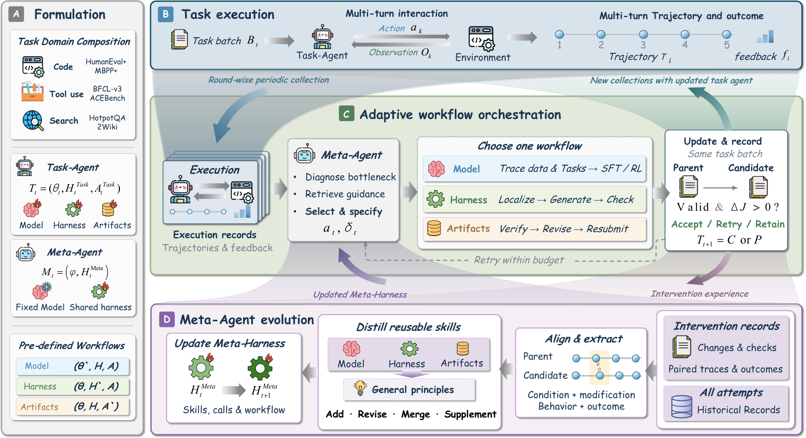

# RSIFlow: Adaptive Self-Improvement Workflows with an Evolving Meta-Agent

> Beihang University · 2026-10-15 · paper · **闭环** · [论文](https://arxiv.org/abs/2610.21791) · [仓库](https://github.com/1HUAN1/RSI-Flow)
> 机制族：自改写元智能体与谱系 · 来源核验 2026-10-18 · 复现状态 not-run

## Pipeline

任务智能体（Qwen3-4B/8B）执行任务并收集轨迹与环境反馈；元智能体（GPT-5.6 Sol）诊断当前瓶颈部件，自适应选择部件专属的改进工作流——模型更新（固定单 epoch 超参与全局批 8 的局部 LoRA）、harness 更新或任务产物修订。元层递归在于：工作流结果被蒸馏为部件专属技能与跨部件原则，并整合进 Meta-Harness（元智能体自己的编排层），使后续轮次诊断与编排更好——元智能体参数从不更新。共五轮演化，每轮至多两次尝试。

*图源：Figure 2 (Overview.png), arXiv HTML 2610.21791v1*
## 结果（作者报告，非本地复现）

六基准（HumanEval+、MBPP+、BFCL-v3、ACEBench、HotpotQA、2Wiki）总体均值：Qwen3-4B 51.21 对 SIA 45.15、Hyperagent 41.26、AFlow 40.73（另 SFT 41.12、GRPO 42.04、HarnessForge 41.22、MermaidFlow 43.59）；Qwen3-8B 59.86 对 SIA 56.00、AFlow 54.27。消融（4B、R=5）：相对原始版本三域均值 +13.72；自适应编排平均超最佳固定部件流程 4.13–8.81；关闭元智能体演化损失 5.74 点。

## 证据边界

任务侧基座仅 Qwen3-4B/8B（集群规模与更大基座未探索）；元环带来额外计算开销，更廉价的元智能体可能折损演化收益；经验驱动的 Meta-Harness 更新稳定性未充分研究（作者把反事实分析与元智能体参数优化列为未来工作）；这些基准上强基线密集、余量有限。

## 对 nanoRSI 的输入

瓶颈诊断路由是 nanoRSI 主循环的一种选择器设计：先分类哪个面（技能文本、harness 代码、评测器产物）是约束瓶颈，再施加该面专属算子，而不是把尝试预算花在错误面上。把编排结果蒸馏为可复用元技能与 ADOPTION #53 在技能轨对应；论文的固定对自适应消融正是面路由提案需要的对照。

## 来源

[arXiv abs 2610.21791](https://arxiv.org/abs/2610.21791) · [arXiv HTML v1](https://arxiv.org/html/2610.21791v1) · [RSI-Flow code](https://github.com/1HUAN1/RSI-Flow)
