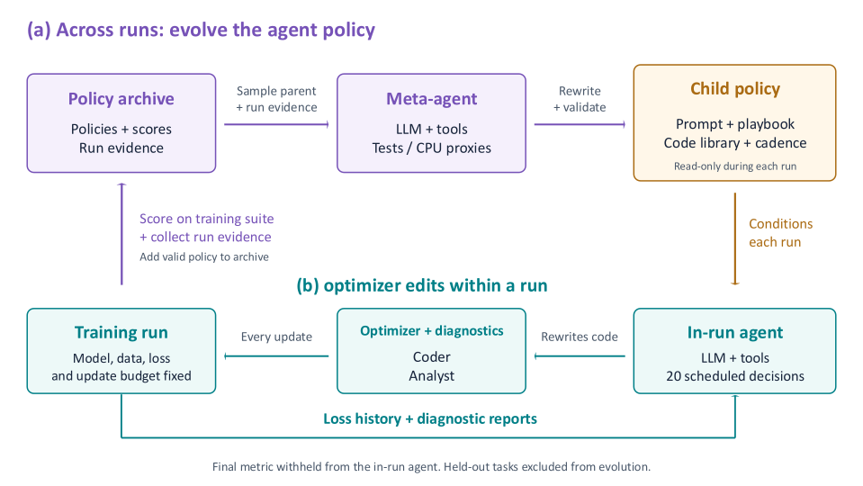

# RSI-Opt: Recursive Self-Improvement for Optimizer Design

> Purdue University / 独立研究者 · 2026-10-23 · paper · **闭环** · [论文](https://arxiv.org/abs/2610.32026)
> 机制族：自改写元智能体与谱系（手写深记） · 来源核验 2026-10-28 · 复现状态 not-run（未找到专属代码/权重/数据包）

## Pipeline

两层嵌套循环，演化对象都是**显式可检查的策略对象**。**外层（跨运行）**：元智能体演化一个策略对象 = 提示模板 + 自然语言操作手册 + 已验证优化器/诊断程序代码库 + 决策节奏；子代经校验后在训练套件上评估，全部合法策略进 DGM 式档案，父代按分数偏置采样。**内层（运行中）**：LLM 编码智能体通过可编辑的优化器接口，在预定的决策点读损失历史与诊断，改写两个程序——`coder`（更新规则）与 `Analyst`（只读诊断）——而模型、数据、损失与更新预算全部固定；最终指标对运行内智能体保密（防奖励作弊）。这套"提示+手册+代码库+节奏"正是把人们通常散落在系统提示里的知识显式化为可版本化对象。

*图源：Figure 1 (overview.svg)，arXiv HTML 2610.32026v1*

## 结果（作者报告，非本地复现）

- 演化：5 代 21 个合法策略（无非法子代），档案最高分 +14.63（第 4 代 p016）。
- 训练套件（z-score 和）：Opus 5.5 单智能体 +10.48 → +14.33；GPT-5.5 +4.33 → +14.10；GPT-6.1 +9.90 → +14.21。
- 留出集：GPT-5.5 −0.36 → +3.11；GPT-6.1 +0.80 → +4.30；**Opus 5.5 反而 +5.22 → +4.87**（6 个留出任务赢 4 个均值）——作者如实报告了强模型的退化。
- PDE 任务：Burgers 1D 相对 L2 误差较固定提示智能体降约 2.7×（Opus）/8.8×（GPT-6.1，4.82e-3 → 5.46e-4）；热方程约 2×。
- 关键对照：冻结首次变更的控制达 +14.56（与全演化几乎持平）；未编辑的库模板在留出 ML 上 −21.80（ViT 掉到 35% 对静态 56%）。

## 证据边界

留出集上 Opus 5.5 轻微退化、且"冻结首次变更"几乎追平全演化——提示**单次好编辑 + 其余是漂移**的解读同样成立，作者保留该对照值得肯定。无公开代码，数字不可独立核验；训练套件与留出任务的划分由作者自定。未编辑模板 −21.80 说明底座模板很弱，基线选择影响增益幅度。

## 对 nanoRSI 的输入

与 v0.5 的经验库/拒绝记忆高度同构：把"提示模板+手册+代码库+节奏"当作 harness 面上的显式工件族（我们的 systemprompt/guardrails/memory/scripts 已对应大半）。可直接借的两条：①策略对象全量入档、父代按分数偏置采样（我们的 selection 目前只盲选 final，可加"档案采样"模式）；②**冻结首次变更对照**应当成为 nanoRSI 每次采纳后的标准审计列——它便宜且能区分"真递归收益"与"一次好运编辑"。

## 来源

[arXiv abs 2610.32026](https://arxiv.org/abs/2610.32026) · [arXiv HTML v1](https://arxiv.org/html/2610.32026v1)
