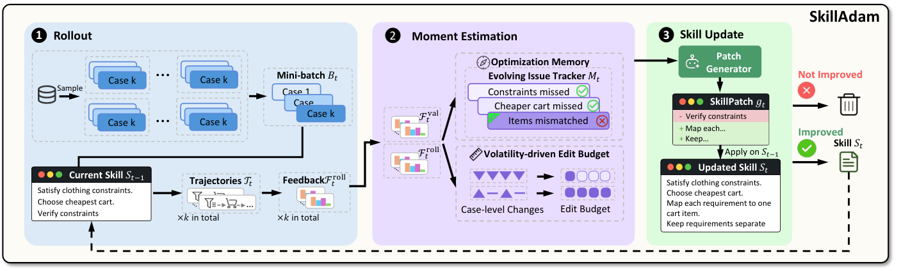

# SkillAdam: Stable and Efficient Skill Evolution for Agents

> Renmin University of China / Tencent · 2026-09-08 · paper · **闭环** · [论文](https://arxiv.org/abs/2609.08944) · [仓库](https://github.com/ruc-datalab/SkillAdam)
> 机制族：技能文件优化与技能库 · 来源核验 2026-09-17 · 复现状态 not-run

## Pipeline

目标模型保持冻结，只优化持久的自然语言技能。每轮在抽样小批次上执行当前技能，把案例级问题与结果写入演化问题跟踪器（方向记忆），估计近期改进波动，并由两种状态共同约束下一次补丁范围。候选只有在指定指标提升且受保护指标不退化时才接受；被接受技能与优化状态进入下一轮。

*图源：Figure 2*
## 结果（作者报告，非本地复现）

作者报告：覆盖短程与长程任务的七个基准上，相比列出的基线取得当时最优结果，同时使用更少优化轮次和更低成本。论文报告一项累积消融：加入优化记忆后 DeepPlanning 平均分从 19.2% 升至 21.7%；主协议六个基准使用 GPT-5.5，DeepPlanning 使用 Claude Sonnet 4.5，受控采样种子为 42。

## 证据边界

报告闭环有界且绑定基准：六个基准只遍历一次优化池，准入决策没有额外验证集，最终测试划分只评测一次。记忆消融是累积消融而非孤立的交互分析；尚未证明跨任务迁移、固定预算下的多轮复利或独立外部闸门。

## 对 nanoRSI 的输入

对 nanoRSI：在技能面增加小型持久优化状态记录——问题历史加有界编辑预算——同时保持现有评估器冻结。在匹配 rollout 预算下比较无状态编辑、仅问题记忆、仅波动预算和组合状态；报告接受编辑、退化、编辑规模、token 及留出迁移。这是实验提案，不是已实现功能或本地复现。

## 来源

[arXiv abstract](https://arxiv.org/abs/2609.08944) · [Paper HTML v1 (Figure 2, protocol, results)](https://arxiv.org/html/2609.08944v1) · [Official implementation (MIT)](https://github.com/ruc-datalab/SkillAdam) · [Repository license (MIT)](https://raw.githubusercontent.com/ruc-datalab/SkillAdam/main/LICENSE)
