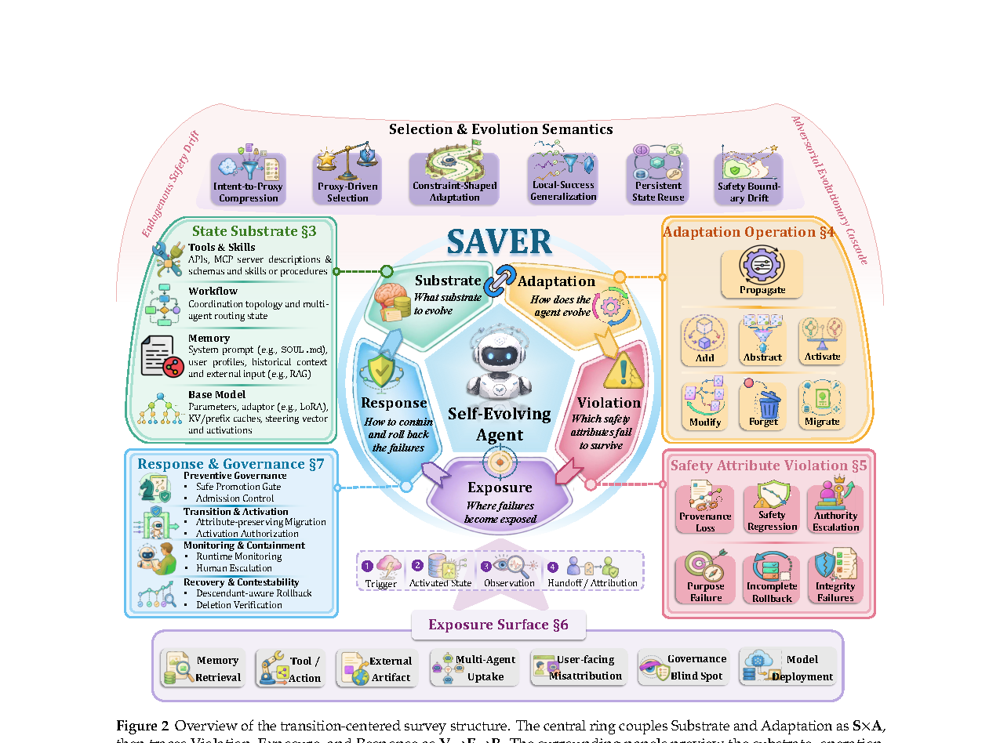

# Safety in Self-Evolving Agents: A Survey

> Zhejiang University / Huazhong University of Science and Technology / Xi'an Jiaotong University / NUDT / Shanghai Jiao Tong University 等 · 2026-09-08 · paper · **支撑·无闭环** · [论文](https://arxiv.org/abs/2610.00093) · [仓库](https://github.com/xaddwell/awesome-self-evolving-agent-safety)
> 机制族：安全与治理 · 来源核验 2026-10-15 · 复现状态 not-run

## Pipeline

综述（无新机制）：为持续从经验更新可复用状态（参数、记忆、工具、技能、工作流）的 agent 重新定义安全——'过去的事件成为未来的原因'后，一个语境中无害的信息可能在更大持久性、权限或范围上影响后续决策。提出转移中心的 SAVER 分析框架：Substrate（可复用影响栖身何处）、Adaptation（如何变化）、Violation（破坏哪些安全属性）、Exposure（失败在哪里显形）、Response（遏制、修复、撤销）。语料：683 篇编码论文（579 注册 + 48 补充 + 56 附加），577 篇可视化子集。

*图源：Figure 2, PDF page 4 (HTML figure rendering failed; rendered from PDF at 150 dpi): overview of the transition-centered survey structure - the central Substrate x Adaptation ring with Violation, Exposure and Response traces and taxonomy panels*
## 结果（作者报告，非本地复现）

给出跨切面结论而非基准数字：当适应超出其有效性条件时，合法经验也能催生不安全状态；准入、检索、激活、暴露与本地遏制的证据充分，但'修复不安全状态的后代'与'评估不安全影响是否再浮现'的证据薄弱；综述主张以回溯到起始转移的纵向评估。

## 证据边界

综述论文：分类与证据制图，无新机制或新数字；覆盖冻结于其注册库构建日。

## 对 nanoRSI 的输入

SAVER 五元分解可作为 nanoRSI 证据账本的核查清单 schema：每条被接受的编辑都可记录载体、适应方式、违反检查、暴露面与响应。综述证据最薄弱的两处——后代修复与再浮现——正对应 nanoRSI 的 rejected_recent 与谱系核验：退役一个不安全技能必须同时处理已从它派生的候选。

## 来源

[arXiv abstract](https://arxiv.org/abs/2610.00093) · [arXiv PDF v1 (figures; HTML rendering failed)](https://arxiv.org/pdf/2610.00093v1) · [Awesome-Self-Evolving-Agent-Safety list](https://github.com/xaddwell/awesome-self-evolving-agent-safety)
