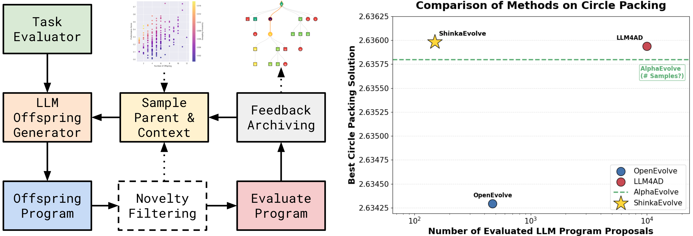

# ShinkaEvolve: Towards Open-Ended And Sample-Efficient Program Evolution

> Sakana AI · 2025-09-17 · paper · **闭环** · [论文](https://arxiv.org/abs/2509.19349) · [仓库](https://github.com/SakanaAI/ShinkaEvolve)
> 机制族：程序进化与进化搜索 · 来源核验 2026-09-29 · 复现状态 not-run

## Pipeline

LLM 修改档案中的程序，以验证器适应度选择下一轮可复用的父代；新颖性筛选与多臂赌博机模型选择提高搜索效率。目标包括 AIME 智能体框架和 MoE 负载均衡损失。

*图源：Figure 1*
## 结果（作者报告，非本地复现）

作者报告以 150 个样本找到优于 AlphaEvolve 的 26 圆装填解。MoE 损失搜索使用 30 代；公告称相对 Global LBL，无效路由减少 5.81%，七个基准的平均表现提高 1.73%。

## 证据边界

目标由人类限定，并依赖外部 LLM；并未证明变异引擎自身持续改进或无界递归自我改进。

## 对 nanoRSI 的输入

建议：增加基于档案的智能体框架搜索示例，固定留出测试，并在父代选择中计入成本。

## 来源

[arXiv original date](https://arxiv.org/abs/2509.19349) · [Sakana announcement and results](https://sakana.ai/shinka-evolve/) · [Official code and license](https://github.com/SakanaAI/ShinkaEvolve)
