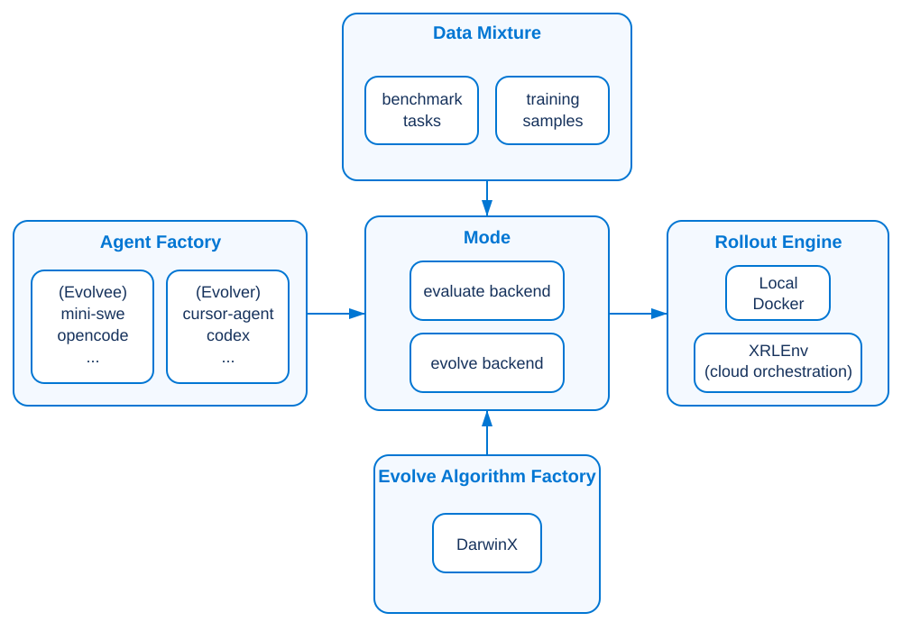

# DarwinX: Evolving Agent Harnesses Through Natural Selection

> Salesforce AI Research · 2026-07-31 · paper · **闭环** · [论文](https://arxiv.org/abs/2608.07545) · [仓库](https://github.com/SalesforceAIResearch/Beagle)
> 机制族：Harness 搜索与进化 · 来源核验 2026-09-21 · 复现状态 not-run

## Pipeline

Beagle 将 agent harness 作为可进化对象，提供评测／进化后端、基准原生 rollout 引擎与 agent 工厂。DarwinX 冻结模型权重，由 evolver 提议 harness 变体，经各基准验证器评分，仅接受不退化且扩展覆盖的候选，并保留替代谱系供重组。

*图源：Official project architecture figure*
## 结果（作者报告，非本地复现）

作者报告 GPT-5.5 high 与 Monet 上的结果：Terminal-Bench 2.1 pass@5 从 75.5 升至 83.2（+7.7 分），TerminalWorld pass@1 从 48.8 升至 56.1（+7.3），WebArena-Infinity pass@1 从 43.5 升至 93.0（+49.5），SWE-bench Verified pass@1 从 80.8 升至 84.2（+3.4）。TerminalWorld 使用训练／测试划分，进化后的 harness 原样迁移到 SWE-bench。

## 证据边界

这些是作者报告结果，不是本地复现。WebArena 最大增益包含新增 browser_execute action。首发版本需要 Docker、uv、服务商凭据与基准基础设施。权重不变；展示的递归面是有界 harness 修订与种群选择，而非开放式持续提升。

## 对 nanoRSI 的输入

建议：围绕 nanoRSI 冻结评测器增加小型 population 模式，保留候选原始增量、回滚后选中增量及替代谱系元数据；在相同任务流与预算下比较单谱系复用和 preserve-and-extend 选择。不要将 Beagle 或其依赖栈引入标准库核心。

## 来源

[DarwinX paper v1](https://arxiv.org/abs/2608.07545) · [Official Beagle repository](https://github.com/SalesforceAIResearch/Beagle) · [Beagle Apache-2.0 license](https://github.com/SalesforceAIResearch/Beagle/blob/main/LICENSE.txt) · [Official Beagle architecture figure](https://github.com/SalesforceAIResearch/Beagle/blob/main/docs/assets/beagle-architecture.svg)
