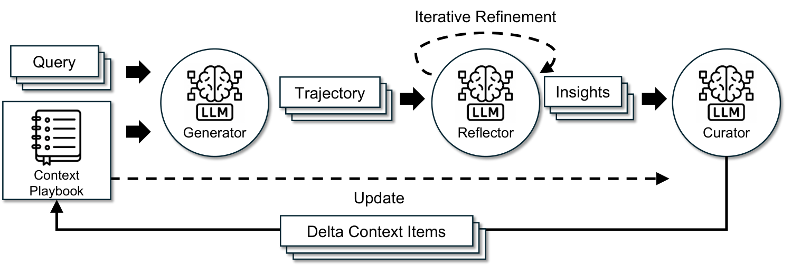

# Agentic Context Engineering: Evolving Contexts for Self-Improving Language Models

> Stanford University / SambaNova Systems / UC Berkeley · 2025-10-06 · paper · **闭环** · [论文](https://arxiv.org/abs/2510.04618) · [仓库](https://github.com/ace-agent/ace)
> 机制族：上下文组织策略 · 来源核验 2026-09-13 · 复现状态 not-run

## Pipeline

生成器轨迹与执行反馈交给反思器，整理器产出局部策略手册增量；通过有益/有害计数及去重，跨任务保留可复用策略，无需更新权重。

*图源：Figure 4*
## 结果（作者报告，非本地复现）

所有角色均使用非思考模式 DeepSeek-V3.1 时，无标准答案的在线 ACE 在 AppWorld 四项 TGC/SGC 指标上平均为 59.5，ReAct 为 42.4，Dynamic Cheatsheet 为 51.9；差值应表述为百分点，而非相对百分比。

## 证据边界

在线评测按顺序先预测、再用该测试任务更新。证据支持有界适应，不涉及权重学习，也不证明更新器自身改进。

## 对 nanoRSI 的输入

建议：在固定任务流上比较版本化增量记忆与整文件重写。

## 来源

[arXiv dates](https://arxiv.org/abs/2510.04618) · [Original paper affiliations, protocol and Table 1](https://arxiv.org/html/2510.04618v1) · [Official implementation](https://github.com/ace-agent/ace)
