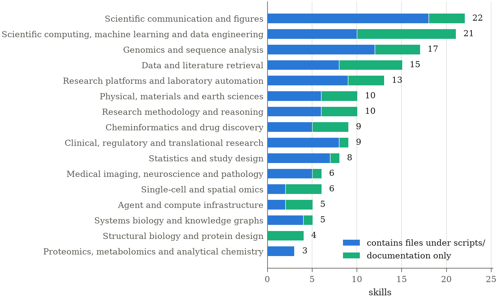

# Scientific Agent Skills: A Library of Procedural Knowledge for Research Agents

> K-Dense AI · 2026-08-30 · paper · **支撑·无闭环** · [论文](https://arxiv.org/abs/2609.00065) · [仓库](https://github.com/K-Dense-AI/scientific-agent-skills)
> 机制族：技能文件优化与技能库 · 来源核验 2026-09-17 · 复现状态 not-run

## Pipeline

非闭环：一个开放许可的科研程序知识技能库，16 个科学实践领域（基因组、化学信息、医学影像、研究设计、科研传播）共 163 个技能。每个技能是一个目录，以版本化、人类可读的指令文件为中心、按需加载，常附参考资料与可运行脚本——编码了领域接受哪种检验、哪个标识符命名空间是权威。

*图源：Figure 2*
## 结果（作者报告，非本地复现）

无任务级评测与基线；量化内容是预算核算：163 个技能的常驻描述占 200K token 窗口的 7.1%；中位已文档化工作流占其 23.9%；46 个工作流中有 29 个若全量加载参考文件会溢出——故采用惰性按需加载。

## 证据边界

人工策划的静态库：无进化机制、无任务基准；技能质量为人工保障；条目按'面向技能智能体的支撑基础设施'收录，非自改进结果。

## 对 nanoRSI 的输入

对 nanoRSI：其 token 预算核算（常驻描述 vs 惰性加载 vs 溢出）是技能库成本报告的正确格式；人工策划的种子库也是技能进化实验的合法冷启动基线。

## 来源

[arXiv abstract](https://arxiv.org/abs/2609.00065) · [Paper v2 (Figure 2, budget figures)](https://arxiv.org/html/2609.00065v2) · [Library repository (MIT)](https://github.com/K-Dense-AI/scientific-agent-skills)
